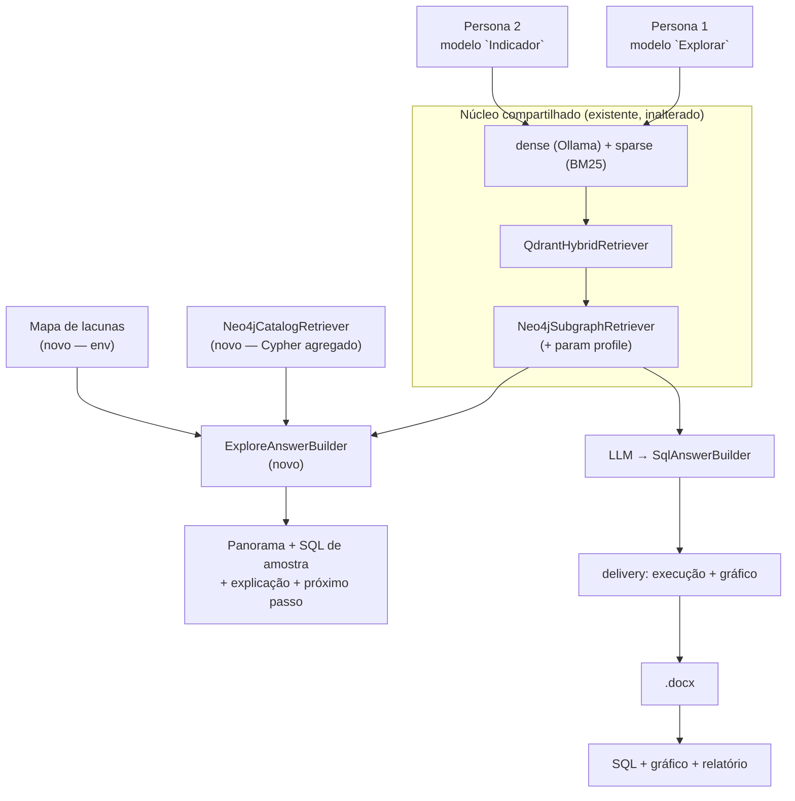

# Plano de implementação — duas personas no assistente

- **Data**: 2026-08-17
- **Contexto**: o produto hoje atende **uma** persona. A adição de uma segunda
  não é uma feature nova em cima do motor — é um **segundo contrato de saída**
  sobre o mesmo motor de recuperação.
- **Decisões que isso gera**: ADR-0014 (personas como modos de uso).

---

## 1. Ponto de partida — o que existe hoje é a Persona 2

O fluxo atual (`pipelines/query` + `pipelines/delivery` + relatório) assume que a
pergunta **já nomeia o indicador**: recupera top-5 cards → subgrafo → gera SQL →
executa via postgres-mcp → gráfico → `.docx`. Todo o tuning medido até aqui
(poda de colunas, `EXPANSION_MODE=evidence`, corte determinístico) otimiza
**precisão sobre poucas tabelas** — é exatamente o que a Persona 2 precisa e
exatamente o que a Persona 1 **não** precisa.

| | **Persona 1 — Explorar** | **Persona 2 — Medir** (hoje) |
|---|---|---|
| pergunta típica | "o que vocês têm sobre habitação no MCid?" | "valor total dos empreendimentos por UF" |
| o que ela sabe | o tema, não o catálogo | o indicador e mais ou menos onde ele mora |
| o que ela quer | mapa do território + o que dá pra perguntar | o número, o SQL e o gráfico |
| entrega | bases, SQL (amostra) e explicação | bases, SQL, explicação **e gráfico** |
| unidade da resposta | **um conjunto** de tabelas/domínios | **uma** tabela certa |
| métrica que importa | **recall** de cobertura (achou tudo que é relevante?) | **precisão** de seleção (escolheu a irmã certa?) |
| falha típica | responder pouco / inventar tabela que não existe | escolher a tabela irmã errada |
| custo | 1 chamada de LLM, sem execução | 2–4 chamadas + execução + render + upload |

**A consequência de arquitetura**: os dois modos querem knobs de recuperação
**opostos** (breadth vs. precisão). Se eu servir os dois com a mesma
configuração, degrado um para atender o outro. Por isso o desenho abaixo trata
persona como **modo com parâmetros próprios**, nunca como env global.

---

## 2. Como o usuário escolhe o modo — a decisão central

**Proposta: dois modelos explícitos no open-webui**, servidos por duas pipelines
Hayhooks. O usuário escolhe no dropdown antes de perguntar:

| modelo no dropdown | pipeline | persona |
|---|---|---|
| `Explorar` | `pipelines/explore` (nova) | 1 |
| `Indicador` | `pipelines/query` (atual, intocada) | 2 |

**Por que não roteamento automático agora** (avaliado e adiado):

- Um classificador de intenção erra em silêncio. O usuário não vê que foi
  roteado errado — vê uma resposta ruim. Hoje eu **não tenho como medir** essa
  taxa: não existe gold de intenção nem volume real de perguntas.
- A IR do ADR-0006/0007 (`intent`) **não serve** para rotear: ela é produzida
  *junto com o SQL*, depois da recuperação. Rotear com ela exigiria uma chamada
  de LLM extra antes de tudo — latência e custo, para resolver um problema que o
  dropdown resolve de graça.
- Escolha explícita dá **segmentação limpa do eval**: cada modo é medido contra
  o seu próprio gold, sem contaminação.

**O que entra no lugar do roteamento**: cada modo **detecta e oferece o outro**.
O modo Explorar termina toda resposta com um convite ("quer que eu meça um desses?
troque para *Medir indicador*"), e o modo Medir, quando não encontra a tabela,
sugere explorar em vez de dizer "refine a pergunta". Roteamento automático fica
como Fase 5, **só depois** de existir gold de intenção.

> **Custo de reverter**: baixo. Se depois decidirmos por modelo único com
> roteador, as duas pipelines viram dois ramos internos — o contrato de saída de
> cada uma não muda.

---

## 3. Arquitetura — o que é reuso e o que é novo

**Regra inegociável**: tudo que a Persona 1 acrescenta é **aditivo**. Nenhum
default de `settings` muda, nenhum caminho da Persona 2 muda de comportamento.
Os knobs do modo Explorar são **argumentos de pipeline**, não variáveis de
ambiente globais — porque `EXPANSION_MODE`, `top_k` e poda são justamente os
parâmetros do baseline medido em `eval/baselines/`.

### Arquivos

| arquivo | o quê |
|---|---|
| `docs/adr/0014-personas-e-modos-de-uso.md` | **novo** — a decisão |
| `src/rag/pipelines/explore/pipeline_wrapper.py` | **novo** — vira o modelo `Explorar` |
| `src/rag/pipelines/explore/explore_pipeline.py` | **novo** — monta a pipeline |
| `src/rag/components/answer/explore_answer_builder.py` | **novo** — contrato de saída da P1 |
| `src/rag/components/retrievers/neo4j_catalog_retriever.py` | **novo** — "o que existe" por Cypher |
| ~~`neo4j_subgraph_retriever.py`~~ | ~~toca~~ — **revisto na implementação, ver abaixo** |
| `src/rag/settings/configs.py` | **toca** — bloco `EXPLORE_*` + `SCOPE_GAPS` |
| `eval/datasets/explore/mcid-explore-v0.1.0.json` | **novo** — gold exploratório |
| `eval/explore/` | **novo** — benchmark próprio (revisto: não estende `eval/answer`) |
| `CLAUDE.md` | **toca** — dois modelos, não um |

> **Atualização de implementação (17/08).** O plano previa parametrizar o
> `Neo4jSubgraphRetriever` com defaults preservando o comportamento. Na
> implementação isso foi **descartado**: a Persona 2 é território medido, e
> deixá-la dentro de um arquivo que passa a mudar por causa da Persona 1
> acoplaria toda evolução futura do modo Explorar ao gate MDD do retrieval da
> Persona 2. O `Neo4jCatalogRetriever` faz as suas próprias consultas. Custo:
> duas Cypher parecidas. Resultado: **o único arquivo existente modificado no
> repositório inteiro é `configs.py`, com 41 linhas acrescentadas e nenhuma
> alterada.** Pelo mesmo motivo, o eval virou `eval/explore/` próprio em vez de
> métricas acrescentadas a `eval/answer/`.

`docker-compose.yaml` **não muda**: o Hayhooks expõe cada diretório de pipeline
como um modelo OpenAI-compat automaticamente.

---

## 4. Contrato de saída do modo Explorar

Seis blocos, nessa ordem — todos **ancorados no catálogo**, nenhum inventado:

1. **Panorama** — domínios/bases que tocam o tema, com nº de tabelas e o rótulo
   de negócio (`OM_DOMAIN_LABELS`), não o nome do schema.
2. **Tabelas candidatas** — nome físico, descrição, **grão** (`OM_GRAIN_KEYS`) e
   colunas-chave. O grão é o que diferencia as irmãs e é justamente o que a
   Persona 1 precisa entender para escolher.
3. **Como elas se conectam** — os `SEMANTIC_JOIN` disponíveis, marcando o que
   exige normalização. Aqui a verdade do grafo aparece: **55/74 tabelas são
   ilhas**, e dizer isso é informação, não defeito.
4. **O que dá para perguntar** — perguntas de exemplo por tabela (Fase 4:
   ancoradas nos títulos reais dos 171 charts do Superset).
5. **SQL de amostra** — `SELECT ... LIMIT 20` ou contagem por categoria, para a
   pessoa *ver o dado*. Não é o SQL de um indicador.
6. **O que eu não tenho** — lacunas conhecidas para aquele tema, explícitas.
   Ex.: *"não tenho execução orçamentária; tenho valor contratado e
   desembolsado"* — a **recusa informativa** (item C2 do plano de 13/08), que na
   Persona 1 vale muito mais do que na 2.

**Sem gráfico e sem relatório na Fase 2** (a Persona 1 pediu bases, SQL e
explicação). Execução do SQL de amostra fica atrás de `EXPLORE_EXECUTE_SAMPLE`,
default **desligado** — ligo depois de medir.

### Parâmetros de recuperação do modo Explorar

| knob | Persona 2 (hoje) | Persona 1 | por quê |
|---|---|---|---|
| `top_k` | 5 | **15** | cobertura, não precisão |
| `EXPANSION_MODE` | `evidence` | **`all`** | "o que se conecta a isso" é a pergunta |
| poda de colunas | 25 / 6 | **8 / 4** | ela quer a tabela, não o dicionário completo |
| agrupamento | — | **por domínio** | a resposta é um mapa, não uma lista |

---

## 5. As três coisas que o motor atual não sabe fazer

**(a) Responder "o que existe".** "Quais bases vocês têm?" não é uma pergunta
semântica — é uma consulta de catálogo. Embedding responde mal a isso por
construção. O `Neo4jCatalogRetriever` responde por Cypher agregado
(determinístico, sem LLM, sem alucinação): domínios e contagem; tabelas por
domínio; detalhe de uma tabela; vizinhos de uma tabela. O LLM só **narra** o que
o Cypher devolveu.

**(b) Declarar lacunas.** Hoje, quando o conceito está fora da ingestão, o
sistema **acerta ao recusar** — mas recusa mal ("refine a pergunta"). Um mapa
`SCOPE_GAPS` em env (`{conceito: "o que existe no lugar"}`, no mesmo padrão do
`OM_GRAIN_KEYS`) transforma isso em resposta útil. Cobre `__dados_brutos.*` e
`empreendimento_rural.*`, que estão fora do escopo.

**(c) Sugerir perguntas.** O que a Persona 1 mais quer — "o que dá pra fazer com
isso" — é exatamente o que os 171 charts do Superset já respondem em produção.
O extrator de `tabela → títulos de charts` já está planejado (item A3). Aqui ele
tem um uso **sem o problema metodológico** de contaminação: sugerir perguntas não
é ser avaliado por elas.

---

## 6. Handoff entre os modos

O `run_chat_completion` recebe o histórico completo de mensagens, mas hoje só lê
a última (`get_last_user_message`). Trocar de modelo no open-webui **preserva o
histórico** — então o handoff é barato: o modo Medir passa a ler as últimas N
mensagens e, se a anterior foi um panorama do modo Explorar, injeta a lista de
tabelas como **contexto de exploração** no prompt.

Efeito: *"quero medir a segunda que você mostrou"* funciona. **Fase 4** — envolve
tocar no prompt do gerador, então passa pelo gate de eval da resposta.

---

## 7. Eval — como eu sei que a Persona 1 funciona

O ADR-0012 exige métrica antes de mudança. As métricas atuais **não servem** para
a Persona 1: `expected_table_match` assume uma tabela certa; aqui o gabarito é um
**conjunto**.

**Gold novo**: `mcid-explore-v0.1.0.json`, 15–20 perguntas exploratórias, cada uma
com `expected_tables` (conjunto), `expected_domains` e `expected_gaps`.

| métrica | definição | alvo |
|---|---|---|
| `coverage_recall@15` | fração das tabelas-gold que aparecem no panorama | maximizar |
| `catalog_fidelity` | tabelas citadas ⊆ catálogo real | **1,0 — obrigatório** |
| `domain_precision` | domínios listados que são pertinentes | maximizar |
| `gap_disclosure` | declarou a lacuna quando o gold diz que existe | maximizar |

**Guardrail da Persona 2**: `eval-quick` + `expected_table_match` no
`mcid-v0.1.0` **não podem regredir** — o único arquivo compartilhado que eu toco
é o `Neo4jSubgraphRetriever`, e a mudança lá é a introdução de parâmetros cujo
default reproduz o comportamento atual. Rodo o gate antes e depois mesmo assim.

---

## 8. Fases, esforço e aceite

| # | fase | entrega | esforço | aceite |
|---|---|---|---|---|
| 1 | **ADR-0014 + gold exploratório** | a decisão escrita + 15–20 casos | ~3h | gold revisado por vocês |
| 2 | **Modo Explorar (MVP)** | pipeline `explore` + `ExploreAnswerBuilder` + params no subgraph retriever | ~6h | `catalog_fidelity` = 1,0; P2 sem regressão no `eval-quick` |
| 3 | **Catálogo + lacunas** | `Neo4jCatalogRetriever` + `SCOPE_GAPS` | ~4h | "quais bases existem" respondida sem LLM inventar nada; `gap_disclosure` > 0 |
| 4 | **Sugestões + handoff** | prior do Superset nas sugestões + contexto entre modos | ~4h | "medir a segunda que você mostrou" funciona; gate de resposta da P2 |
| 5 | **Roteamento automático** *(opcional)* | classificador + `mode_accuracy` | ~4h | só com gold de intenção pronto |
| 6 | **Relatório `.docx` de catálogo** *(opcional)* | reusa o tema, conteúdo novo | ~3h | — |

**Dependências**: 2 depende de 1; 3 e 4 dependem de 2; 4 também depende do
extrator A3. 5 e 6 são independentes e ficam por último.

**Caminho crítico até algo demonstrável**: fases 1+2 ≈ **9h** → já dá para pôr as
duas personas na frente de um usuário real.

---

## 9. Riscos

| risco | mitigação |
|---|---|
| **Alucinação de tabela** — na Persona 1 é fatal (a pessoa não tem como conferir) | referências ancoradas no subgrafo/Cypher, igual o `SqlAnswerBuilder` já faz; `catalog_fidelity` = 1,0 é gate, não meta |
| **Regressão silenciosa na Persona 2** | nada de env global; params com default idêntico; `eval-quick` antes/depois |
| **Usuário escolhe o modo errado** | nomes explícitos no dropdown + cada modo oferece o outro na última linha |
| **Duplicação de código entre as pipelines** | núcleo compartilhado (embedders + híbrido + subgrafo) numa função só; diverge apenas no prompt e no answer builder |
| **Prompt maior (top_k 15)** engordar latência/custo | a P1 não executa SQL nem renderiza gráfico nem gera `.docx` — deve ficar **mais rápida** que a P2 mesmo com prompt maior; medir na Fase 2 |
| **Seed recall ~30%** (gap conhecido) machuca mais a P1 | `top_k` 15 + expansão `all` compensam parcialmente; o lever de fundo continua sendo o item 1 do backlog |

---

## 10. O que eu preciso de vocês

1. **Confirmar o roteamento por dropdown** (§2) — é a decisão que trava o resto.
   Se vocês preferirem modelo único com detecção automática, a Fase 5 sobe para
   primeira e o eval de intenção vira pré-requisito (+1 semana).
2. **Revisar o gold exploratório** da Fase 1 — 15–20 perguntas que a Persona 1
   realmente faria. Sem isso eu escrevo as perguntas *e* a resposta, e o número
   não vale nada.
3. **Decisão de escopo** (já pendente do plano de 13/08): `__dados_brutos.*` e
   `empreendimento_rural.*` entram na ingestão? Se **não**, a Fase 3 (lacunas)
   sobe de importância — vira a forma honesta de dizer o que falta.

## 11. Fora de escopo, com motivo

| item | por quê |
|---|---|
| gráfico no modo Explorar | a Persona 1 pediu bases, SQL e explicação; gráfico sem indicador definido é enfeite |
| memória de conversa persistente | o handoff da Fase 4 resolve o caso real com o histórico que o open-webui já manda |
| autenticação/perfil de usuário por persona | dropdown resolve; perfil só faz sentido com multiusuário real |
| mudar o tuning do retrieval da Persona 2 | está medido e saturado; a Persona 1 não é motivo para mexer |
