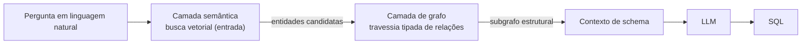

# ADR-0001: GraphRAG como estratégia de recuperação

- **Status**: Proposto
- **Data**: 2026-07-21
- **Autores**: arthrok (graphrag-tais)
- **Revisores**: -

## Introdução ao problema

O objetivo do projeto é gerar **SQL correto** a partir de uma pergunta em
linguagem natural sobre um acervo de dados. O que torna um SQL correto não é
apenas *encontrar as tabelas certas*, é conhecer a **estrutura que as liga**:

- qual coluna referencia qual (chave estrangeira) para montar o `JOIN`;
- qual é a **granularidade** de cada tabela, para não contar a mesma entidade
  duas vezes (fan-out) — ex.: `COUNT(*)` vs `COUNT(DISTINCT beneficiario_id)`;
- de onde um dado veio (lineage), para escolher o *mart* certo em vez da fonte
  bruta;
- como uma métrica é definida.

Essa informação é **relacional e tipada**. Uma busca por **similaridade
semântica** — o coração do RAG tradicional — recupera trechos "parecidos" com a
pergunta, mas **não sabe percorrer relações**: ela não deduz que
`fct_pagamentos.beneficiario_id` referencia `dim_beneficiario.id`. Precisamos
decidir a **estratégia de recuperação** antes de qualquer escolha de ferramenta,
porque é ela que define quais camadas o sistema terá.

## Decisão

Adotamos **GraphRAG**: a recuperação é feita em **duas camadas complementares**.

1. **Camada semântica (busca vetorial)** — traduz a linguagem natural, muitas
   vezes ambígua ("faturamento" → coluna `revenue`), em um conjunto de
   **entidades candidatas** (tabelas, colunas, métricas).
2. **Camada de grafo (travessia tipada de relações)** — a partir dessas
   candidatas, percorre **relações explícitas** (FK, lineage, métrica,
   granularidade) para montar o **subgrafo estrutural** que embasa o SQL.

O motivo central da escolha é a **travessia em relações**: é ela que fornece os
JOINs, a cardinalidade e a granularidade que a busca vetorial sozinha não dá.

Esta ADR decide **apenas a estratégia** (o padrão de duas camadas). *Quais*
tecnologias implementam cada camada — o banco de grafo e o vector store — e *de
onde* vêm os dados são decisões separadas, registradas nos ADRs seguintes.

## Alternativas consideradas

### Alternativa A: LLM puro (text-to-SQL direto, sem recuperação)

- Descrição: mandar a pergunta (e talvez o schema inteiro) para o LLM e pedir o SQL.
- Prós: simplicidade máxima.
- Contras: **alucina** tabelas/colunas que não existem; o schema completo não cabe
  no contexto em catálogos grandes; erra JOIN e cardinalidade. Para dados públicos,
  um número errado é pior que nenhum.

### Alternativa B: RAG vetorial puro (só a camada semântica)

- Descrição: indexar descrições de tabelas/colunas e recuperar as mais parecidas.
- Prós: fácil; bom para "quais tabelas falam de X".
- Contras: recupera **peças isoladas**, não a estrutura que as conecta. Sem FK,
  cardinalidade e grain, o LLM ainda tem que adivinhar os JOINs — que é justamente
  onde o SQL quebra.

### Alternativa C: Grafo puro (só a camada de travessia)

- Descrição: modelar tudo em grafo e entrar por match lexical/estruturado.
- Prós: ótimo para percorrer relações.
- Contras: a **entrada** a partir de linguagem natural ambígua é fraca sem vetor;
  exigiria heurísticas lexicais frágeis para mapear "mulher negra" → colunas
  `sexo`/`raca_cor`.

### Não fazer nada / manter status quo

- Descrição: continuar escrevendo SQL à mão consultando o catálogo.
- Por que não: elimina o próprio motivo do projeto.

## Tradeoffs

### Vantagens

- **[Alto impacto]** Ataca diretamente as duas maiores causas de SQL errado
  (JOIN inválido e fan-out), porque a travessia tipada fornece FK e granularidade.
- **[Alto impacto]** Reduz alucinação: o LLM opera sobre o subgrafo real recuperado,
  não sobre memória.
- **[Médio impacto]** Combina o melhor das duas abordagens: entrada semântica
  tolerante a ambiguidade + estrutura precisa para o SQL.

### Desvantagens

- **[Alto impacto]** Introduz **duas camadas** (e, como se verá, dois
  armazenamentos) — mais peças para operar e manter sincronizadas do que um RAG
  vetorial simples.
- **[Médio impacto]** Só entrega valor se as **relações existirem** na fonte de
  metadados (FK, lineage, grain). Sem elas, a camada de grafo tem pouco a percorrer.

### Avaliação

Os ganhos superam os custos: nenhuma alternativa mais simples (A, B, C) entrega
SQL estruturalmente correto, e correção é o requisito central. O custo — duas
camadas — é aceito conscientemente e detalhado nos ADRs de tecnologia. O risco
ativo a monitorar é a **completude das relações** na fonte, endereçado no ADR de
fonte de metadados.

## Consequências

- **Positivas**: define a espinha dorsal do sistema (semântica + travessia) e abre
  as decisões subsequentes (banco de grafo, vector store, fonte, ingestão).
- **Negativas**: assume a complexidade de manter duas camadas coordenadas.
- **Ações decorrentes**:
  - Escolher a tecnologia da camada de grafo (ADR-0002).
  - Escolher a tecnologia da camada semântica (ADR-0003).
  - Definir a fonte de metadados e a ingestão (ADR-0004 e ADR-0005).
  - Nota: **detecção de comunidades (Leiden/GDS)** é uma *evolução* desta
    estratégia (expansão semântica para perguntas globais), não parte do núcleo —
    será tratada em ADR próprio quando amadurecer.

## Referências

- [GraphRAG with Qdrant and Neo4j](https://qdrant.tech/documentation/examples/graphrag-qdrant-neo4j/)
- [Microsoft GraphRAG — Dataflow](https://microsoft.github.io/graphrag/index/default_dataflow/)
- [ADR-0000: Escopo do projeto e MCid como base de desenvolvimento](./0000-escopo-do-projeto-e-mcid-como-base.md)
