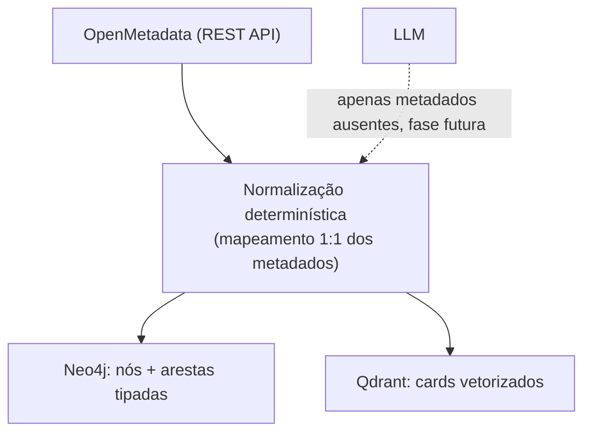

# ADR-0004: OpenMetadata como fonte de metadados e ingestão determinística

- **Status**: Proposto
- **Data**: 2026-07-21
- **Autores**: arthrok (graphrag-tais)
- **Revisores**: -

## Introdução ao problema

Definidas as camadas (ADR-0001) e suas tecnologias — Neo4j (ADR-0002) e Qdrant
(ADR-0003) —, falta responder: **de onde vêm os nós, as arestas e os cards?**

O grafo precisa ser *populado* com entidades (tabelas, colunas, métricas) e,
principalmente, com as **relações tipadas** (FK, lineage) que dão sentido à
travessia. Há duas formas gerais de obter isso:

- **Extrair de texto com um LLM** (abordagem do GraphRAG "clássico": o modelo lê
  documentos e infere entidades/relacionamentos) — cara, não-determinística e
  sujeita a alucinação.
- **Ler de uma fonte já estruturada** de metadados, quando ela existe.

No nosso contexto, essa fonte estruturada **existe**: o **OpenMetadata** é o
catálogo de dados da organização e já expõe, de forma estruturada, tabelas,
colunas, constraints, joins observados, métricas, lineage (tabela e coluna),
domínios, produtos de dados e glossário.

## Decisão

Adotamos o **OpenMetadata como fonte de verdade dos metadados**, consumido pela
sua **REST API**, e a ingestão é **determinística** (sem LLM na construção do
grafo).

- Cada entidade do OpenMetadata é **mapeada diretamente** para nós/arestas do
  grafo e para *cards* vetorizáveis — sem inferência probabilística.
- O **LLM não participa da construção do grafo**. Ele fica reservado para
  (a) interpretar a pergunta e gerar o SQL (tempo de consulta) e (b), numa fase
  futura, **complementar apenas o que não está explícito** no catálogo — inferir
  granularidade ausente, classificar tabela como fato/dimensão, resumir
  comunidades.

**Reuso GovHub-wide (plug-and-play).** Esta decisão tem uma consequência
estratégica: como **todos os projetos do GovHub são catalogados no mesmo
OpenMetadata**, o RAG se conecta a **um único ponto** — o catálogo — em vez de a
cada banco de cada projeto, em ambientes distintos. Servir outro projeto do GovHub
(o MCid usado no desenvolvimento, o MinC como entrega, o IPEA depois — ver
[ADR-0000](./0000-escopo-do-projeto-e-mcid-como-base.md)) vira essencialmente
**troca de configuração** (quais *services*/*domains*/*databases* do OpenMetadata
ingerir), sem reengenharia nem novas credenciais por banco. É o que torna o RAG
genérico e portável entre projetos.

A escolha da REST API (em vez do SDK Python de ingestão do OpenMetadata) é
proposital: menos dependências pesadas e controle direto sobre os campos
requisitados e o parsing.

## Alternativas consideradas

### Alternativa A: Extrair metadados direto dos bancos (information_schema)

- Descrição: ler catálogos nativos (ex.: `information_schema`) de cada banco fonte.
- Prós: não depende do OpenMetadata.
- Contras: dá tabelas/colunas/PK/FK, mas **não** dá lineage, métricas, glossário,
  domínios nem joins observados — exatamente o que enriquece a travessia. E
  espalha o acesso por N bancos heterogêneos.

### Alternativa B: Construir o grafo com LLM a partir de documentação/texto

- Descrição: um LLM lê docs e extrai entidades/relacionamentos (GraphRAG clássico).
- Prós: funciona quando **não há** fonte estruturada.
- Contras: caro, lento, não-determinístico e sujeito a alucinar relações. Desperdiça
  o fato de já termos metadados estruturados no OpenMetadata.

### Alternativa C: Artefatos do dbt (manifest/catalog)

- Descrição: ler `manifest.json`/`catalog.json` do dbt.
- Prós: ricos em lineage de modelos e testes.
- Contras: cobrem só o que é dbt; o OpenMetadata já **agrega** dbt e outras fontes
  num modelo único — usá-lo evita amarrar a ingestão a uma ferramenta de transformação.

### Não fazer nada

- Descrição: popular o grafo manualmente.
- Por que não: não escala e desatualiza no primeiro deploy.

## Tradeoffs

### Vantagens

- **[Alto impacto]** Ingestão **determinística**: reprodutível, barata, sem custo
  de LLM nem alucinação na construção do grafo.
- **[Alto impacto]** Aproveita relações **já curadas** (lineage, joins, métricas)
  que seriam caríssimas de reconstruir.
- **[Alto impacto]** **Reuso plug-and-play no GovHub**: um único ponto de conexão
  (o catálogo) para todos os projetos; trocar de projeto é trocar configuração, não
  reintegrar bancos em ambientes distintos.
- **[Médio impacto]** Uma fonte única e agregada (o catálogo) em vez de N bancos.

### Desvantagens

- **[Alto impacto]** **Dependência da qualidade/completude do catálogo**: se FK,
  lineage, descrições ou **granularidade** não estiverem documentados no
  OpenMetadata, o grafo nasce pobre nessas relações.
- **[Médio impacto]** Acoplamento à **API do OpenMetadata**: os campos e o parsing
  variam por versão do produto.

### Avaliação

Os ganhos superam os custos: ter uma fonte estruturada torna a ingestão
determinística — uma vantagem enorme frente ao GraphRAG por LLM. O custo real e
**persistente** é a dependência da qualidade dos metadados; ele é mitigável (o LLM
pode, numa fase futura, inferir o que faltar, ex.: grain), mas permanece como
**risco ativo**: a qualidade do sistema é limitada pela qualidade do catálogo.

## Consequências

- **Positivas**: ingestão barata e reprodutível; reaproveita curadoria existente.
- **Negativas**: o valor do sistema fica atrelado à completude do OpenMetadata;
  parsing sensível à versão da API.
- **Ações decorrentes**:
  - Implementar o componente de leitura da REST (`OpenMetadataSource`).
  - **Smoke-test** contra uma instância real e ajuste dos `fields=`/parsing por
    versão do OM.
  - Planejar a etapa (futura) de **enriquecimento por LLM** só para metadados
    ausentes (grain, classificação fato/dimensão).

## Referências

- [ADR-0000: Escopo do projeto e MCid como base de desenvolvimento](./0000-escopo-do-projeto-e-mcid-como-base.md)
- [ADR-0002: Neo4j como banco da camada de grafo](./0002-neo4j-como-banco-de-grafo.md)
- [ADR-0003: Qdrant como vector store da camada semântica](./0003-qdrant-como-vector-store.md)
- [OpenMetadata — Documentação](https://docs.open-metadata.org/)
