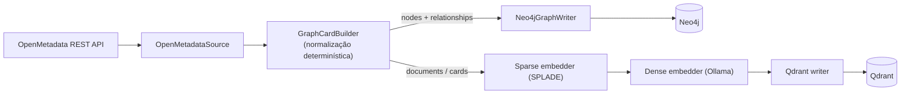

# ADR-0005: Ingestão do OpenMetadata para Neo4j e Qdrant

- **Status**: Substituído por ADR-0011
- **Data**: 2026-07-21
- **Autores**: arthrok (graphrag-tais)
- **Revisores**: -

## Introdução ao problema

O [ADR-0004](./0004-openmetadata-como-fonte-de-metadados.md) estabeleceu o
OpenMetadata como fonte e a ingestão como determinística. Falta definir **como**
essa ingestão escreve nos dois armazenamentos — Neo4j (ADR-0002) e Qdrant
(ADR-0003) — de forma **coordenada**, já que a arquitetura de duas camadas
(ADR-0001) depende de os dois ficarem consistentes entre si.

As questões concretas são:

- Como uma entidade do OpenMetadata vira, ao mesmo tempo, **nós/arestas** no grafo
  e **card vetorizado** no vetor?
- Como o vetor "sabe" a qual nó do grafo ele corresponde (a **costura**)?
- Como reexecutar a ingestão sem **duplicar** dados (idempotência)?

## Decisão

A ingestão é um **pipeline único** que lê o OpenMetadata uma vez, normaliza cada
entidade e faz **escrita dupla** — grafo no Neo4j e cards no Qdrant — usando o
**`node_id` (o *fullyQualifiedName* da entidade) como chave de costura** entre os
dois.

Regras da decisão:

1. **`node_id = fullyQualifiedName`**. Estável, legível e único; é gravado como
   propriedade do nó no Neo4j **e** no *payload* do ponto no Qdrant. É ele que
   permite, na recuperação, ir do card encontrado no Qdrant ao nó no Neo4j.
2. **Um card por entidade pesquisável** (tabela, coluna, métrica, termo), com
   contexto suficiente para ser semanticamente útil (uma coluna `status` sozinha
   não é — o card inclui a tabela e o papel semântico). Nem tudo que existe no
   grafo é vetorizado.
3. **Idempotência por `MERGE`**: a escrita no Neo4j usa `MERGE` por `node_id`
   (nós) e por par origem/destino (arestas), de modo que reexecutar a ingestão
   **atualiza** em vez de duplicar.
4. **Escrita coordenada, não transacional entre bancos**: como são dois sistemas
   distintos, não há transação distribuída; a consistência é *eventual* e garantida
   pela reexecução idempotente a partir da mesma fonte.

Todas as etapas são **componentes Haystack** (custom quando necessário), conforme
a convenção do projeto: `OpenMetadataSource`, `GraphCardBuilder`,
`Neo4jGraphWriter`, embedders e writer do Qdrant.

## Alternativas consideradas

### Alternativa A: Escrever só no Neo4j e derivar os embeddings a partir do grafo

- Descrição: popular o grafo primeiro e, num segundo passo, ler o grafo para gerar
  os cards e vetorizar.
- Prós: uma "fonte" intermediária única (o grafo).
- Contras: adiciona um passo e um acoplamento (o vetor depende de reler o grafo);
  não simplifica a costura — o `node_id` continua necessário. Sem ganho real.

### Alternativa B: Escrever só no Qdrant e guardar as relações no payload

- Descrição: abrir mão do grafo e serializar relações no metadado do vetor.
- Prós: um banco a menos.
- Contras: contraria os ADR-0001/0002 — payload não faz **travessia multi-hop**.
  Regride para o "RAG vetorial puro" já rejeitado.

### Alternativa C: Chave de costura por UUID interno do OpenMetadata

- Descrição: usar o `id` (UUID) do OpenMetadata como `node_id`.
- Prós: imutável mesmo se a entidade for renomeada.
- Contras: opaco para depuração e para o Cypher escrito à mão; o `fqn` é legível e
  suficientemente estável para o v1. (Pode ser reavaliado se renomeações frequentes
  virarem um problema — aí um ADR substituto.)

### Não fazer nada

- Descrição: cada banco ingerido por um processo separado, sem chave comum.
- Por que não: sem costura, a recuperação em duas camadas não funciona.

## Tradeoffs

### Vantagens

- **[Alto impacto]** A costura por `node_id` torna a recuperação em duas camadas
  possível e simples (o card do Qdrant aponta direto para o nó do Neo4j).
- **[Médio impacto]** `MERGE` idempotente permite **re-sincronizar** rodando a
  ingestão de novo, sem limpeza manual.
- **[Médio impacto]** Pipeline único (uma leitura da fonte, escrita dupla) mantém
  os dois bancos alinhados por construção.

### Desvantagens

- **[Alto impacto]** **Consistência eventual entre bancos**: uma falha parcial pode
  deixar Neo4j e Qdrant momentaneamente dessincronizados até a próxima execução.
- **[Médio impacto]** Reprocessar tudo a cada sync é simples porém **pouco
  incremental**; catálogos grandes vão pedir ingestão incremental/por diff depois.
- **[Baixo impacto]** `fqn` como chave exige cuidado com renomeações de entidades.

### Avaliação

Os ganhos superam os custos: a costura por `node_id` + escrita dupla idempotente é
o caminho mais simples que satisfaz a arquitetura das ADRs anteriores. Os custos
são de **operação em escala** (consistência eventual e reprocessamento total), que
são aceitáveis no v1 e endereçáveis depois (ingestão incremental, reconciliação).
Risco ativo: dessincronização em falhas parciais — mitigada por reexecução.

## Consequências

- **Positivas**: os dois bancos ficam consistentes por construção; re-sync é só
  rodar de novo; tudo em componentes Haystack reutilizáveis.
- **Negativas**: consistência eventual; ingestão não-incremental no v1.
- **Ações decorrentes**:
  - Manter os componentes de ingestão (`OpenMetadataSource`, `GraphCardBuilder`,
    `Neo4jGraphWriter`) e o pipeline `ingest`.
  - Planejar **ingestão incremental / por diff** para catálogos grandes.
  - Definir uma rotina de **reconciliação** (detectar nós órfãos entre os bancos).
  - Registrar em ADR próprio o **modelo detalhado do grafo** (labels, propriedades,
    arestas derivadas como `CAN_JOIN`) e a **estratégia de vetorização** (cards por
    tipo, quotas na recuperação).

## Referências

- [ADR-0001: GraphRAG como estratégia de recuperação](./0001-graphrag-como-estrategia-de-recuperacao.md)
- [ADR-0002: Neo4j como banco da camada de grafo](./0002-neo4j-como-banco-de-grafo.md)
- [ADR-0003: Qdrant como vector store da camada semântica](./0003-qdrant-como-vector-store.md)
- [ADR-0004: OpenMetadata como fonte de metadados](./0004-openmetadata-como-fonte-de-metadados.md)
- Implementação: [`src/rag/components/`](../../src/rag/components/) e
  [`src/rag/pipelines/ingest/`](../../src/rag/pipelines/ingest/)
