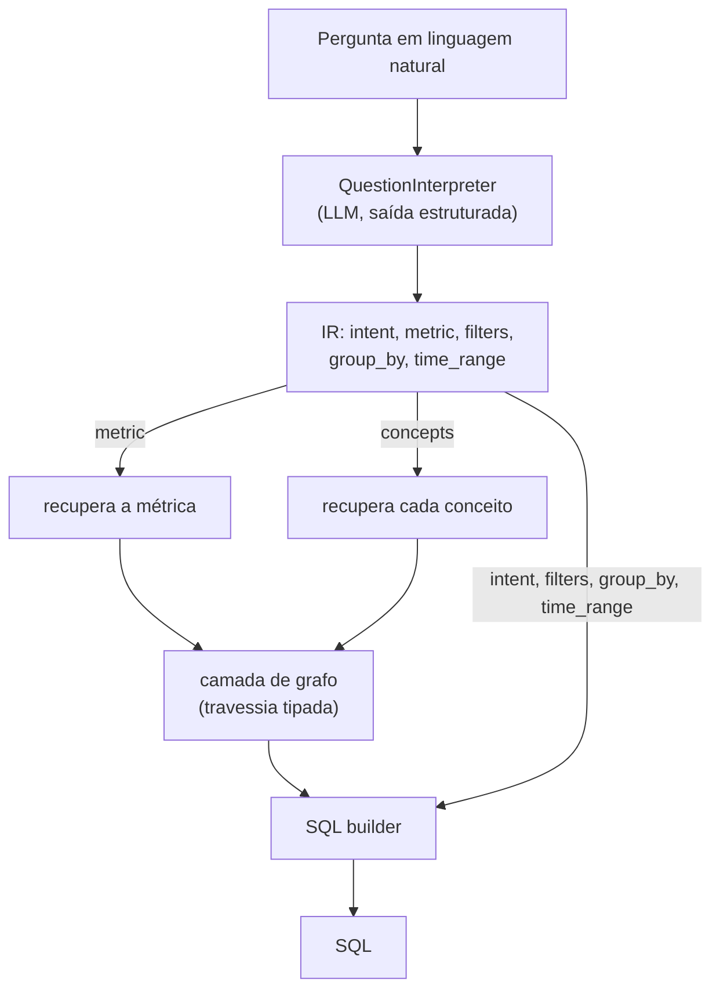

# ADR-0006: Interpretação da pergunta em uma representação estruturada (IR)

- **Status**: Proposto
- **Data**: 2026-07-21
- **Autores**: arthrok (graphrag-tais)
- **Revisores**: -

## Introdução ao problema

O [ADR-0001](./0001-graphrag-como-estrategia-de-recuperacao.md) definiu que a
recuperação tem uma **camada semântica** de entrada. A pergunta em questão é: o que
exatamente entra nessa camada?

Uma pergunta em linguagem natural — *"quantas mulheres negras recebem bolsas no
IPEA?"* — mistura, numa só frase, várias coisas distintas: **o que medir** (uma
contagem/agregação), **o que filtrar** (sexo, raça), **como agrupar** e **em que
janela de tempo**. Se essa frase for jogada inteira num embedder e usada como
consulta única:

- a recuperação fica **imprecisa** — o vetor da frase inteira dilui os vários
  conceitos, e não dá para aplicar *quotas por tipo* (ver ADR-0005) nem rotear cada
  conceito para o seu alvo;
- **valores** ("mulheres negras") ficam presos na frase em vez de virarem
  condições explícitas de filtro;
- não há **ponto de controle** inspecionável antes de gerar SQL (para validar,
  aplicar *guardrails*, logar ou depurar).

Precisamos decidir **como a pergunta é representada** antes da recuperação e da
geração do SQL.

## Decisão

Antes da recuperação, a pergunta passa por um estágio de **interpretação** que a
converte em uma **representação estruturada intermediária (IR)** — um JSON tipado —
usando um **LLM com saída estruturada** (JSON validado contra um schema Pydantic).

Exemplo (para *"quantas mulheres negras recebem bolsas?"*):

```json
{
  "intent": "aggregate",
  "metric": "total_beneficiarios",
  "filters": [
    { "concept": "sexo", "value": "feminino" },
    { "concept": "raca", "value": ["preta", "parda"] }
  ],
  "group_by": [],
  "time_range": null
}
```

Schema da IR (v1):

| Campo | Tipo | Papel |
|---|---|---|
| `intent` | enum (`aggregate`, `count`, `list`, `compare`, `trend`, …) | Define a **forma** do SQL |
| `metric` | string \| null | Nome de **negócio** da métrica (ex.: `total_beneficiarios`) |
| `filters` | lista de `{concept, value}` | `concept` é termo de negócio; `value` é escalar **ou** lista |
| `group_by` | lista de `concept` | Dimensões de agrupamento |
| `time_range` | null \| `{start, end, grain}` | Janela e granularidade temporal |

**Princípio central — a IR fala em conceitos de negócio, não em schema físico.**
Os campos `metric`, `concept` e `group_by` usam termos de **glossário** (`sexo`,
`raca`, `total_beneficiarios`), **não** nomes de tabela/coluna. O mapeamento
conceito → coluna acontece **depois**, na recuperação (busca híbrida + termos de
glossário) e na travessia do grafo. Isso mantém a interpretação **agnóstica ao
schema de cada projeto** — coerente com o objetivo de RAG genérico do GovHub
([ADR-0000](./0000-escopo-do-projeto-e-mcid-como-base.md)): a mesma interpretação
serve MinC, MCid e IPEA, porque não depende dos nomes físicos de nenhum deles.

A IR então **direciona a recuperação**: cada `concept`/`metric` vira um alvo de
busca próprio (com quotas por tipo), em vez de uma única consulta pela frase toda.



Este estágio é implementado como um **componente Haystack custom**
(`QuestionInterpreter`), o **primeiro** da pipeline de query, refinando o fluxo do
ADR-0001 (que estabeleceu as camadas sem definir a entrada).

## Alternativas consideradas

### Alternativa A: Sem interpretação — embutir a pergunta crua e recuperar

- Descrição: usar a frase inteira como consulta de recuperação (o que o scaffold v1
  faz hoje).
- Prós: mais simples; uma chamada de LLM a menos.
- Contras: recuperação imprecisa (embedding da frase inteira), sem roteamento por
  conceito nem quotas por tipo, sem extração de valores de filtro e sem ponto de
  controle antes do SQL.

### Alternativa B: Interpretar direto para SQL (sem IR)

- Descrição: uma chamada NL → SQL usando o schema recuperado.
- Prós: menos etapas.
- Contras: é o **objetivo final**, mas fazê-lo de um golpe perde o roteamento
  estruturado da recuperação e o ponto de controle inspecionável; acopla o
  entendimento ao schema cedo demais, o que reduz a portabilidade e aumenta a
  alucinação. (A IR não substitui a geração de SQL — ela a **alimenta**.)

### Alternativa C: IR já vinculada ao schema (com nomes de tabela/coluna)

- Descrição: interpretar direto para colunas/tabelas físicas.
- Prós: menos um passo de mapeamento.
- Contras: exige o schema **no momento da interpretação** (a recuperação ainda nem
  aconteceu — problema do ovo e da galinha), acopla a um projeto específico e quebra
  o objetivo genérico do GovHub.

### Alternativa D: Parsing por regras/gramática (sem LLM)

- Descrição: gramática/regex para extrair intenção e filtros.
- Prós: determinístico, sem custo de LLM.
- Contras: frágil para linguagem aberta; não lida com sinônimos/paráfrases; custo de
  manutenção alto. Inviável para perguntas livres de usuários.

### Não fazer nada / manter status quo

- Descrição: seguir com a pergunta crua indo direto para recuperação + LLM.
- Por que não: é a Alternativa A; carrega todas as suas limitações.

## Tradeoffs

### Vantagens

- **[Alto impacto]** **Desacopla entendimento de schema**: a IR fala em conceitos
  de negócio, então a mesma interpretação serve todos os projetos do GovHub (não
  depende dos nomes físicos de nenhum).
- **[Alto impacto]** **Recuperação precisa e roteada**: cada conceito/métrica vira
  um alvo de busca próprio, com quotas por tipo — recall melhor que embutir a frase
  inteira.
- **[Médio impacto]** **Ponto de controle inspecionável**: dá para validar, aplicar
  guardrails, logar e depurar a IR antes de tocar em SQL.
- **[Médio impacto]** **Filtros e intenção estruturados**: `filters` (conceito +
  valor(es)) mapeiam limpo para `WHERE`; `intent` guia a forma do SQL.

### Desvantagens

- **[Médio impacto]** **Chamada extra de LLM**: adiciona latência/custo e pode
  errar (classificar mal a intenção, perder um filtro).
- **[Médio impacto]** **A IR é um contrato a manter/evoluir** (novas intenções,
  comparações, filtros aninhados, faixas de valor).
- **[Baixo impacto]** **Normalização de valores**: "mulheres negras" precisa virar
  `sexo=feminino` e `raca ∈ {preta, parda}` — depende de mapeamento de valores/
  glossário, nem sempre disponível.
- **[Baixo impacto]** **Sobre-estruturação**: nem toda pergunta encaixa na IR — é
  preciso um caminho de *fallback*.

### Avaliação

Os ganhos superam os custos: o desacoplamento conceito × schema é o que torna o RAG
genérico entre projetos do GovHub, e o roteamento por conceito melhora diretamente a
recuperação — nenhuma das alternativas mais simples entrega isso. O custo da chamada
extra é aceitável, e o erro de interpretação é mitigável (validação de schema +
*fallback* para recuperação pela frase inteira quando a confiança for baixa). O risco
ativo é a **normalização de valores** (linguagem → valores de domínio), que depende
da cobertura de glossário — a tratar em decisão própria.

## Consequências

- **Positivas**: a pipeline de query ganha um primeiro estágio limpo e agnóstico ao
  projeto; a recuperação passa a ser roteada por conceito; surge um ponto de controle
  antes do SQL.
- **Negativas**: uma chamada de LLM a mais e um contrato de IR para manter; é preciso
  uma estratégia de normalização de valores e um *fallback* para perguntas que não
  encaixam.
- **Ações decorrentes**:
  - Definir o **schema Pydantic da IR** (intent enum, metric, filters, group_by,
    time_range) como contrato versionado.
  - Implementar o componente `QuestionInterpreter` (Ollama com saída estruturada)
    como primeiro estágio da pipeline de query, substituindo o embedding da frase
    crua por recuperação **roteada por conceito**.
  - Definir o caminho de **fallback** (baixa confiança → recuperação pela pergunta
    inteira).
  - Registrar em ADR próprio a **normalização de valores** (linguagem → valores de
    domínio) via glossário.

## Referências

- [ADR-0000: Escopo do projeto e MCid como base de desenvolvimento](./0000-escopo-do-projeto-e-mcid-como-base.md)
- [ADR-0001: GraphRAG como estratégia de recuperação](./0001-graphrag-como-estrategia-de-recuperacao.md)
- [ADR-0005: Ingestão do OpenMetadata para Neo4j e Qdrant](./0005-ingestao-openmetadata-para-neo4j-e-qdrant.md)
