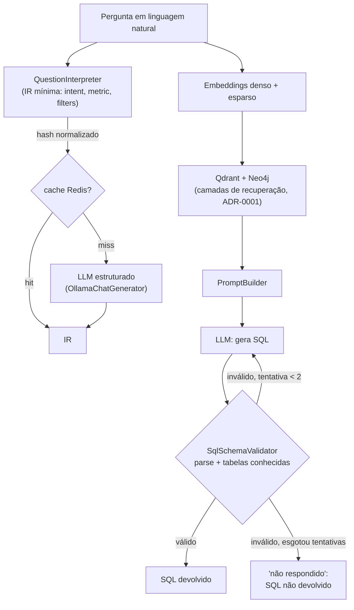

# ADR-0007: Fechamento dos gaps de correção e consistência do v1

- **Status**: Proposto
- **Data**: 2026-07-22
- **Autores**: LuizaMaluf (graphrag-tais)
- **Revisores**: -

## Introdução ao problema

Os ADRs 0001–0006 definiram a arquitetura GraphRAG (duas camadas de
recuperação, Neo4j, Qdrant, ingestão determinística via OpenMetadata e uma
representação intermediária — IR — para a pergunta). A análise que origina
este ADR foi conduzida com a *skill* de arquitetura (framework de
julgamento arquitetural — contexto, alternativas, trade-offs) aplicada
retroativamente à arquitetura já existente, não para propor algo novo do
zero: o objetivo é **clarificar ideias e sugerir soluções** para riscos que os
próprios ADRs anteriores já haviam identificado, cruzando cada decisão
documentada com o estado real do código em `src/rag/`. Essa revisão mostra
que **quatro riscos que os próprios ADRs já assumiram conscientemente seguem
sem nenhuma mitigação implementada**:

1. **Nenhuma validação do SQL gerado antes de devolvê-lo.**
   `src/rag/pipelines/query/query_pipeline.py` termina em `llm.replies`: o
   texto cru gerado pelo LLM é devolvido como "o SQL", sem parse, sem checagem
   de que as tabelas/colunas referenciadas existem no subgrafo recuperado, sem
   qualquer sinal de que o resultado é sequer sintaticamente válido. Isso
   contradiz o objetivo central declarado do projeto — gerar **SQL correto** —
   e é hoje o ponto de maior risco silencioso do sistema.

2. **Consistência eventual entre Neo4j e Qdrant sem mitigação.** O
   [ADR-0005](./0005-ingestao-openmetadata-para-neo4j-e-qdrant.md) já admite
   que uma falha parcial de ingestão pode deixar os dois bancos
   dessincronizados, e lista como ação decorrente "definir uma rotina de
   reconciliação (detectar nós órfãos entre os bancos)" — essa rotina nunca
   foi implementada. Hoje não há nenhum mecanismo, manual ou automático, para
   saber se os dois bancos estão de fato consistentes.

3. **O [ADR-0006](./0006-interpretacao-da-pergunta-em-representacao-estruturada.md)
   está `Proposto`, mas o pipeline roda sobre a alternativa que o próprio ADR
   rejeita.** ADR-0006 descarta explicitamente a "Alternativa A: sem
   interpretação — embutir a pergunta crua e recuperar" por perder roteamento
   por conceito, extração de filtros e ponto de controle antes do SQL. É
   exatamente isso que `query_pipeline.py` faz hoje: a pergunta crua vai direto
   para os embedders. Isso não é uma dívida técnica comum — é o sistema
   operando conscientemente contra sua própria decisão já documentada.

4. **Não existe nenhum teste automatizado no repositório** (confirmado:
   nenhum diretório `tests/`, nenhum `pytest.ini`/`pyproject.toml`, nenhum
   workflow de CI, nenhum `Makefile`). Sem uma rede de regressão, nenhuma das
   três mitigações acima — nem qualquer mudança futura — é verificável além de
   smoke-test manual, o que o próprio README já reconhece como insuficiente
   ("rode um smoke-test antes de confiar").

Os quatro pontos compartilham a mesma natureza: são riscos **já precificados**
pelos ADRs anteriores, não riscos novos. Este ADR decide como fechá-los.

## Decisão

Adotamos quatro mudanças coordenadas na pipeline de query e na operação do
sistema, tratadas como um único esforço de *hardening* do v1 antes de
qualquer evolução nova de escopo (comunidades/Leiden, IR completa,
recuperação híbrida avançada):

### 1. Validador estrutural de SQL com reescrita limitada

Após a geração do SQL, um componente `SqlSchemaValidator` faz **parse
estrutural** (via biblioteca de parsing SQL, sem conexão com banco real) e
confere se toda tabela referenciada está entre as recuperadas no subgrafo. Se
inválido, o erro é realimentado ao LLM para correção, **limitado a 2
tentativas**. Se ainda assim inválido, o sistema devolve explicitamente que
não pode responder com confiança, em vez de retornar SQL não verificado. A
validação é estrutural, não semântica: garante que o SQL parseia e referencia
schema real, não que a lógica de negócio (agregação, granularidade) está
certa — essa é uma limitação reconhecida, não um objetivo desta decisão.

### 2. Reconciliação Neo4j ↔ Qdrant — detecção, não correção automática

Um script (não uma pipeline Haystack) percorre os `node_id` de cada banco e
reporta os que existem em um lado e não no outro. **Não há correção
automática**: um nó órfão pode ser sintoma de um bug real de ingestão, e
"consertar" silenciosamente esconderia esse sinal. No v1 a execução é sob
demanda (operador roda manualmente); agendamento automático fica como
evolução futura.

### 3. IR mínima (núcleo do ADR-0006), com cache

Implementamos o núcleo da representação intermediária definida no ADR-0006 —
apenas `intent`, `metric` e `filters`, **sem** `group_by`/`time_range` — como
o primeiro estágio da pipeline de query, usando um LLM com saída estruturada
(schema JSON validado). Nesta v1 a IR é um **estágio de enriquecimento
não-bloqueante**: ela é calculada e exposta na resposta (ponto de controle
inspecionável, como o ADR-0006 pede), mas ainda **não** reescreve o
roteamento da recuperação por conceito — isso fica para quando houver volume
real de perguntas para validar o contrato completo. O resultado é cacheado no
Redis por um hash normalizado da pergunta, reaproveitando uma instância que já
está provisionada no `docker-compose` e ociosa desde o início do projeto.

### 4. Suíte de testes "golden query" em CI hermético

Uma suíte de testes unitários (do validador) e de regressão "golden query"
(pergunta → forma esperada de SQL) roda em todo PR, **sem** subir Neo4j,
Qdrant ou Ollama reais — o LLM é mockado e os testes usam um subgrafo de
schema fixo. Um tier de testes de integração real (contra os serviços de
fato, rodando sob demanda ou em job noturno) fica deliberadamente fora deste
ADR, para não pagar o custo de *pull* de modelo e provisionamento de
containers em toda alteração de código.

## Alternativas consideradas

### Validação do SQL: executar contra um banco real (réplica de leitura)

- Descrição: em vez de validar estruturalmente, executar (`EXPLAIN` ou de
  fato) o SQL gerado contra uma réplica de leitura de cada projeto do GovHub.
- Prós: pega erros que o parse estrutural não pega (tipos incompatíveis,
  regras específicas do dialeto real).
- Contras: reintroduz exatamente o acoplamento a credenciais por banco que o
  [ADR-0004](./0004-openmetadata-como-fonte-de-metadados.md) evitou de
  propósito ao centralizar tudo no OpenMetadata; exige uma réplica de leitura
  disponível por projeto, que não existe hoje. Fica registrado como evolução
  futura quando essa infraestrutura existir — não descartado, só fora do
  escopo deste ADR.

### Validação do SQL: loop de reescrita sem limite

- Descrição: continuar tentando corrigir o SQL até conseguir.
- Contras: custo de LLM e latência não controlados; o tipo de "eficiência
  aparente" que na prática vira gasto imprevisível. Rejeitada em favor de um
  limite fixo (2 tentativas) com fallback explícito.

### Reconciliação: correção automática (auto-repair)

- Descrição: ao detectar um nó órfão, o próprio job já corrige (reingesta a
  entidade faltante ou remove o ponto/nó excedente).
- Contras: mascara bugs reais de ingestão — um órfão pode ser sintoma de um
  problema no `GraphCardBuilder` que "consertar" silenciosamente escondería.
  Detecção com log visível é o comportamento mais seguro no v1.

### Reconciliação: transação distribuída entre os dois bancos

- Descrição: garantir consistência forte escrevendo Neo4j e Qdrant numa
  transação só.
- Contras: já descartada no próprio [ADR-0005](./0005-ingestao-openmetadata-para-neo4j-e-qdrant.md)
  — são dois sistemas distintos, sem transação distribuída praticável entre
  eles. A reconciliação por detecção é o complemento que faltava, não uma
  substituta dessa decisão.

### IR: implementar o contrato completo do ADR-0006 de uma vez

- Descrição: implementar `intent`, `metric`, `filters`, `group_by` e
  `time_range` já na primeira versão.
- Prós: mais fiel ao ADR-0006; evita uma segunda rodada de mudança de
  contrato depois.
- Contras: sem volume real de perguntas para validar como `group_by` e
  `time_range` se comportam na prática, o risco é desenhar um contrato
  sobre-especificado e ter que refazê-lo. Adiada, não rejeitada — o núcleo
  mínimo já entrega o ponto de controle inspecionável que é o maior ganho
  imediato do ADR-0006.

### IR: manter o status quo (Alternativa A do ADR-0006)

- Descrição: não implementar nada, seguir embutindo a pergunta crua.
- Por que não: é exatamente o gap identificado no problema (item 3); mantém
  o sistema operando contra sua própria decisão documentada.

### Testes: suíte de integração completa em CI (Neo4j + Qdrant + Ollama reais)

- Descrição: cada PR sobe o `docker-compose` completo, incluindo *pull* de um
  modelo Ollama real, e roda testes ponta a ponta.
- Prós: mais fiel — testa o sistema real, não uma simulação.
- Contras: pesado (múltiplos minutos de *pull* de um modelo de alguns GB,
  containers, flakiness sob os limites de recurso do CI) para um repositório
  que hoje não tem nenhum teste — começar pelo tier rápido e hermético dá
  sinal de regressão em segundos, não minutos. Um tier de integração real
  fica registrado como evolução futura (job manual ou noturno), não
  descartado.

### Não fazer nada / manter o status quo

- Descrição: não implementar nenhuma das quatro mudanças agora.
- Por que não é aceitável: os quatro riscos já estão precificados e
  documentados pelos ADRs anteriores como ações decorrentes pendentes; adiar
  indefinidamente significa operar um sistema cujo objetivo central (SQL
  correto) nunca é verificado, e cuja consistência entre bancos nunca é
  observável.

## Validação de mercado

Aplicando a Fase 4 (Validação de Mercado) da *skill* `ai-architect` — cruzando
cada padrão proposto com evidência real de mercado — para julgar se as
escolhas deste ADR estão alinhadas, divergem ou estão desatualizadas frente à
prática atual:

| Padrão / ferramenta | Evidência de mercado | Veredito |
|---|---|---|
| Validação estrutural de SQL via parsing (`sqlglot`), sem execução | Sistemas de text-to-SQL em produção usam exatamente esse padrão — parsear com sqlglot e comparar cada identificador contra o schema real ("schema faithfulness") ([Reintech](https://reintech.io/blog/how-to-build-text-to-sql-system-with-llms-for-database-queries)) | **Alinhado, mas parcial por design.** A prática mais madura de mercado combina isso com um segundo estágio de execução real (rodar contra um banco hospedado, realimentar erros ao LLM) ([K2view](https://www.k2view.com/blog/llm-text-to-sql/)). O ADR já reconhece essa lacuna e a registra como evolução futura ("Validação do SQL: executar contra um banco real"), então a divergência é consciente, não um ponto cego. |
| Reconciliação de órfãos entre stores (Neo4j↔Qdrant), detecção sem correção automática | Dual-write entre um store primário e um vector store gera exatamente esse risco de órfãos, mitigado por jobs de reconciliação em background ([Encore](https://encore.dev/blog/you-probably-dont-need-a-vector-database)); times descrevem esses fluxos evoluindo para "resolver automaticamente inconsistências baseadas em exceção" | **Diverge parcialmente.** O padrão de mercado mais maduro já avança para correção automática, não só detecção. Manter apenas detecção no v1 é uma escolha deliberada e razoável (evitar mascarar bugs de ingestão reais), mas o destino natural — se a operação amadurecer — é reconciliação automática supervisionada, não detecção manual indefinida. Vale registrar isso como próximo passo explícito, não deixar como decisão implícita permanente. |
| IR mínima via saída estruturada (JSON Schema) como estágio de *query understanding* | É o padrão recomendado hoje: reduzir a tarefa do LLM para "produzir um JSON que segue um schema conhecido" é a prática de produção mais confiável, e roteadores de RAG baseados em saída estruturada são padrão estabelecido ([Let's Data Science](https://letsdatascience.com/blog/structured-outputs-making-llms-return-reliable-json), [Cohere](https://docs.cohere.com/docs/structured-outputs)) | **Alinhado** — e reforça uma simplificação: como a decodificação restringida (`response_format` do Ollama) já garante conformidade de schema, o fallback do `QuestionInterpreter` para erro de parse é rede de segurança extra, não o mecanismo principal de confiabilidade. |
| Suíte "golden query" com LLM mockado em CI, testes de integração real adiados | É exatamente a prática recomendada: golden sets de 50–200 casos rodando a cada release, cliente LLM mockado em testes unitários para eliminar custo e *flakiness*, testes de integração real como camada separada ([FutureAGI](https://futureagi.com/glossary/llm-regression-testing/), [Traceloop](https://www.traceloop.com/blog/automated-prompt-regression-testing-with-llm-as-a-judge-and-ci-cd)) | **Alinhado** — a ordem de prioridade proposta neste ADR (mock primeiro, integração real depois) é literalmente a sequência recomendada pela prática atual de *regression testing* de aplicações LLM. |

O único ponto que este cruzamento de mercado sugere reconsiderar — sem mudar a
decisão deste ADR, apenas para registrar como direção futura mais explícita —
é o item de reconciliação: hoje descrita só como "evolução futura" nas
Consequências, mas a evidência de mercado indica que é o passo mais provável
de ser cobrado cedo, não um "nice to have" distante.

## Tradeoffs

### Vantagens

- **[Alto impacto]** Fecha o maior gap de correção do sistema: hoje o SQL
  gerado nunca é conferido antes de ser devolvido; o validador estrutural dá
  a primeira garantia real, sem custo de execução contra um banco de
  produção.
- **[Alto impacto]** Reduz o risco de dessincronização silenciosa entre
  Neo4j e Qdrant, já assumido como dívida consciente no ADR-0005 e nunca
  antes endereçado.
- **[Médio impacto]** Implementa o núcleo do ADR-0006 sem assumir o contrato
  completo antes de haver volume real de perguntas para validá-lo —
  entrega o ponto de controle inspecionável sem o risco de sobre-especificar
  cedo demais.
- **[Médio impacto]** Aproveita infraestrutura já provisionada e paga (Redis)
  que estava ociosa desde o início do projeto, reduzindo custo de LLM em
  perguntas repetidas.
- **[Médio impacto]** Cria a primeira rede de segurança de regressão do
  projeto (zero testes hoje) sem pagar o custo pesado de infraestrutura
  completa em CI a cada PR.

### Desvantagens

- **[Alto impacto]** Validação estrutural não é validação semântica: o
  `SqlSchemaValidator` pega SQL sintaticamente inválido ou referência a
  tabela inexistente, mas **não** pega, por exemplo, agregação sem
  `GROUP BY` correto ou `JOIN` que produz fan-out — os dois problemas que o
  próprio [ADR-0001](./0001-graphrag-como-estrategia-de-recuperacao.md)
  cita como motivação central do GraphRAG. É uma rede de segurança parcial,
  não uma prova de corretude — precisa ficar documentado como limitação
  explícita, para não virar falsa sensação de segurança.
- **[Médio impacto]** O loop de reescrita, mesmo limitado a 2 tentativas,
  adiciona latência no caminho de erro: perguntas que hoje "erram rápido"
  (devolvendo SQL errado sem aviso) passam a "errar devagar" (com até 3
  chamadas de LLM antes de desistir).
- **[Médio impacto]** A reconciliação só detecta — encontrar um órfão não o
  corrige; a correção ainda depende de rodar a ingestão de novo ou de
  intervenção manual. É visibilidade, não resolução automática.
- **[Médio impacto]** A IR mínima, sem roteamento de recuperação por
  conceito, entrega só parte do valor prometido pelo ADR-0006 (o ponto de
  controle, mas ainda não a melhoria de recall por roteamento) — risco de
  ser lida como "ADR-0006 resolvido" quando está só parcialmente endereçado.
- **[Baixo impacto]** A suíte de testes hermética (LLM mockado) não captura
  regressão real de prompt ou de comportamento do modelo — só regressão na
  lógica de validação/parsing em torno dele.
- **[Baixo impacto]** Uma nova dependência de parsing SQL e o primeiro uso de
  `pydantic.BaseModel` fora de `configs.py` no projeto — pequeno aumento de
  superfície de manutenção.

### Avaliação

Os ganhos superam os custos: os quatro itens não introduzem complexidade
nova — pagam dívida que os próprios ADRs 0001–0006 já orçaram e deixaram como
ação decorrente pendente. O custo de não agir (SQL nunca verificado, bancos
potencialmente dessincronizados sem visibilidade, uma decisão documentada
sendo contrariada pelo próprio código, zero rede de regressão) é maior do que
o custo de implementar as quatro mitigações propostas, todas deliberadamente
mínimas em escopo. O risco ativo a monitorar daqui para frente é a **falsa
sensação de segurança**: SQL "estruturalmente válido" não é SQL
"semanticamente correto", e IR "mínima" não é o ADR-0006 "completo" — ambas
as limitações precisam continuar visíveis (em documentação e, idealmente, na
própria resposta da API) para não serem lidas como mais do que são.

## Consequências

- **Positivas**: primeira garantia de qualidade no caminho crítico do
  sistema (SQL antes nunca verificado → agora verificado estruturalmente);
  visibilidade sobre dessincronização entre Neo4j e Qdrant; base concreta
  para a IR completa quando houver demanda real; primeira rede de regressão
  automatizada do projeto.
- **Negativas**: quatro novas superfícies de código a manter (validador,
  script de reconciliação, interpretador de pergunta + cache, suíte de
  testes); nova dependência de parsing SQL e de `pytest`; primeiro uso de
  `pydantic.BaseModel` fora de `configs.py`; latência adicional no caminho de
  erro da geração de SQL.
- **Ações decorrentes**:
  - Ordem de implementação recomendada: validador de SQL primeiro (maior
    gap de correção) → esqueleto de testes (infra de CI) → reconciliação →
    IR mínima + cache — validador e reconciliação são independentes entre si
    e podem ser paralelizados; IR mínima toca os mesmos arquivos de pipeline
    que o validador, então deve vir depois para evitar retrabalho de merge.
  - Registrar como evolução futura, não parte deste ADR: validação semântica
    do SQL via execução real contra réplica de leitura; IR completa
    (`group_by`, `time_range`) e roteamento de recuperação por conceito;
    tier de testes de integração real (nightly/manual) contra os serviços
    de fato; agendamento automático da reconciliação (hoje sob demanda) —
    este último priorizado à frente dos demais, por ser o item que a
    validação de mercado (ver seção própria) indica como o passo mais
    provável de ser cobrado cedo, não um "nice to have" distante.
  - Atualizar `docs/adr/README.md`: adicionar este ADR ao índice e remover
    "Ingestão incremental / reconciliação entre Neo4j e Qdrant" da lista de
    temas candidatos a ADR — a reconciliação passa a estar coberta aqui
    (a ingestão incremental em si segue como tema em aberto).

## Referências

- [ADR-0001: GraphRAG como estratégia de recuperação](./0001-graphrag-como-estrategia-de-recuperacao.md)
- [ADR-0002: Neo4j como banco da camada de grafo](./0002-neo4j-como-banco-de-grafo.md)
- [ADR-0004: OpenMetadata como fonte de metadados e ingestão determinística](./0004-openmetadata-como-fonte-de-metadados.md)
- [ADR-0005: Ingestão do OpenMetadata para Neo4j e Qdrant](./0005-ingestao-openmetadata-para-neo4j-e-qdrant.md)
- [ADR-0006: Interpretação da pergunta em uma representação estruturada (IR)](./0006-interpretacao-da-pergunta-em-representacao-estruturada.md)
- [sqlglot — SQL parser em Python](https://github.com/tobymao/sqlglot)
- [Ollama — Structured outputs (`format`)](https://ollama.com/blog/structured-outputs)
- **Validação de mercado (Fase 4 da skill `ai-architect`)**:
  - [Reintech — How to Build a Text-to-SQL System with LLMs](https://reintech.io/blog/how-to-build-text-to-sql-system-with-llms-for-database-queries)
  - [K2view — LLM Text-to-SQL Solutions: Top Challenges and Tips](https://www.k2view.com/blog/llm-text-to-sql/)
  - [Encore — pgvector Guide: Vector Search and RAG in PostgreSQL](https://encore.dev/blog/you-probably-dont-need-a-vector-database)
  - [Let's Data Science — Structured Outputs: Making LLMs Return Reliable JSON](https://letsdatascience.com/blog/structured-outputs-making-llms-return-reliable-json)
  - [Cohere — How do Structured Outputs Work?](https://docs.cohere.com/docs/structured-outputs)
  - [FutureAGI — LLM Regression Testing Guide (2026)](https://futureagi.com/glossary/llm-regression-testing/)
  - [Traceloop — Automated Prompt Regression Testing with LLM-as-a-Judge and CI/CD](https://www.traceloop.com/blog/automated-prompt-regression-testing-with-llm-as-a-judge-and-ci-cd)
- Implementação: `src/rag/pipelines/query/query_pipeline.py`,
  `src/rag/pipelines/query/pipeline_wrapper.py`,
  `src/rag/components/validators/`, `src/rag/components/interpreters/`,
  `src/rag/scripts/reconcile.py`, `tests/`.
