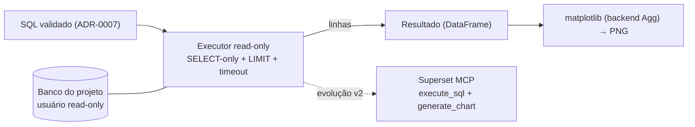

# ADR-0008: Execução do SQL e visualização no v1 (conexão read-only + matplotlib)

- **Status**: Proposto
- **Data**: 2026-07-23
- **Autores**: Davi (graphrag-tais)
- **Revisores**: -

## Introdução ao problema

Os ADRs 0001–0007 levam a pergunta até o **SQL**: recuperação em duas camadas
([ADR-0001](./0001-graphrag-como-estrategia-de-recuperacao.md)) → SQL
estruturalmente validado ([ADR-0007](./0007-fechamento-dos-gaps-de-correcao-e-consistencia-do-v1.md)).
Mas o produto não termina no SQL: para **plotar um gráfico** e **explicar um
dado**, é preciso **executar** a consulta e obter **linhas reais**. Nenhum ADR
até aqui define **de onde vêm os dados executados**.

Há uma tensão herdada que precisa ser resolvida explicitamente:

- O [ADR-0004](./0004-openmetadata-como-fonte-de-metadados.md) centralizou os
  metadados no OpenMetadata **justamente para não espalhar credencial por
  banco**; e o [ADR-0007](./0007-fechamento-dos-gaps-de-correcao-e-consistencia-do-v1.md)
  rejeitou "validar SQL contra banco real" pelo mesmo motivo (não há réplica de
  leitura por projeto).
- Ao mesmo tempo, **não existe gráfico nem explicação sem dado**, e não existe
  dado sem executar SQL contra o banco real em algum ponto.

Essa decisão precisa ser tomada **agora** porque **toda a camada de entrega**
(gráfico, explicação, relatório) depende de existir dado executado — sem ela,
nada disso sai do papel. Restrições conhecidas: LGPD / on-prem (execução e dados
não saem da infra) e o fato de o v1 ser desenvolvido sobre **um único projeto**,
o MCid ([ADR-0000](./0000-escopo-do-projeto-e-mcid-como-base.md)).

## Decisão

No **v1**, o SQL gerado é **executado por uma conexão read-only direta** ao banco
do projeto (um componente Haystack custom), e o **gráfico é plotado com
matplotlib** a partir do resultado. A integração com o **Superset (via MCP)** —
que executaria o SQL **reusando as conexões já cadastradas** e ainda geraria
gráficos nativos/persistíveis — fica registrada como a **evolução v2**, não
implementada agora.

Regras da decisão:

1. **Execução read-only direta.** Um componente custom (no padrão do projeto)
   recebe o SQL **já validado** e o executa contra o banco-alvo via
   driver/SQLAlchemy, devolvendo as linhas (DataFrame). A conexão é parametrizada
   por env, no mesmo padrão `pydantic-settings` do resto (ex.: `TARGET_DB_URL`).
2. **Guardrails obrigatórios (o SQL é gerado por LLM).** Usuário de banco
   **read-only**; **SELECT-only** garantido pelo parse estrutural que já existe
   (`sqlglot`, do [ADR-0007](./0007-fechamento-dos-gaps-de-correcao-e-consistencia-do-v1.md)) —
   rejeita DDL/DML; `LIMIT` default aplicado; `timeout` de query. **Só executa
   SQL que passou pelo validador.**
3. **Plotagem com matplotlib** em backend não-interativo (Agg); a saída é um
   artefato **PNG** (imagem), não texto. O *tipo* de gráfico e as colunas dos
   eixos são derivados do resultado + intenção — o detalhe da forma do gráfico é
   responsabilidade da camada de apresentação (decisão própria, futura).
4. **Escopo de credencial mínimo (v1 = um banco).** Como o desenvolvimento é no
   MCid, basta **uma** conexão read-only — não N bancos. Isso mantém a
   divergência do [ADR-0004](./0004-openmetadata-como-fonte-de-metadados.md)
   **mínima, contida e reversível**.
5. **Superset como v2.** Quando o produto precisar de (a) execução **sem** o
   graphrag-tais segurar credencial (reuso das conexões do Superset) e (b)
   gráficos interativos/persistíveis no BI, a execução + plotagem migram para o
   Superset MCP (`execute_sql`, `create_virtual_dataset`,
   `generate_chart`/`generate_explore_link`). **A fronteira de saída do motor não
   muda** (SQL + contexto): troca-se apenas o executor/renderizador.

## Alternativas consideradas

### Alternativa A: Executar via Superset MCP já no v1

- Descrição: delegar `execute_sql` ao Superset desde já; os dados voltam para o
  matplotlib (ou usa-se o chart nativo do Superset).
- Prós: não segura credencial (o Superset já tem a conexão); alinhado ao
  ADR-0004; caminho direto para chart nativo/persistível.
- Contras: mais peças no v1 (MCP configurado, mapa `service` → `database_id`,
  Superset com a conexão do projeto); **se o chart é matplotlib, usa-se o Superset
  só como proxy de SQL** — ferramenta grande para função pequena; há *gotchas*
  conhecidos de Jinja em *virtual dataset*. Adiada, não descartada — é o v2.

### Alternativa B: Conexão read-only direta + matplotlib (escolhida)

- Descrição: o motor executa o SQL numa conexão read-only e plota com matplotlib.
- Por que foi escolhida: menos peças, caminho coeso `SQL → DataFrame → plot`,
  controle total do DataFrame, e **escopo de credencial mínimo** (um banco, MCid).

### Alternativa C: Não executar — devolver só o SQL

- Descrição: o motor entrega o SQL e para; o usuário roda onde quiser.
- Contras: inviabiliza gráfico e explicação, que precisam de dado. É essencialmente
  o estado atual — não fecha o produto.

### Não fazer nada / manter status quo

- Descrição: seguir entregando só SQL, sem execução.
- Por que não: idêntico à Alternativa C — a camada de entrega nunca sai do papel.

## Tradeoffs

### Vantagens

- **[Alto impacto]** Destrava a camada de entrega (dado real para gráfico e
  explicação) com o **mínimo de peças** no v1.
- **[Alto impacto]** Caminho **coeso e de baixa latência**: `SQL → DataFrame →
  matplotlib`, sem round-trip de MCP nem dataset intermediário.
- **[Médio impacto]** Reaproveita o validador estrutural (ADR-0007) como
  **guardrail SELECT-only** — a mesma peça que valida também protege a execução.
- **[Médio impacto]** **Divergência contida e reversível**: um só banco,
  read-only, com caminho de saída explícito (v2/Superset).

### Desvantagens

- **[Alto impacto]** **Reintroduz credencial por banco** — exatamente o
  acoplamento que o ADR-0004 evitou e o ADR-0007 rejeitou para validação. É uma
  divergência **consciente**, mitigada por: um único banco no v1, usuário
  read-only, guardrails, e o Superset como caminho de quitação dessa dívida no v2.
- **[Médio impacto]** Executar SQL gerado por LLM contra banco real tem risco
  (query cara, exposição de dado) — mitigado por read-only + `LIMIT` + `timeout`
  + SELECT-only.
- **[Médio impacto]** matplotlib gera **imagem estática** (sem a interatividade/
  persistência que o Superset daria) — aceitável no v1, resolvido no v2.
- **[Baixo impacto]** Novas dependências (driver/SQLAlchemy, matplotlib) e dois
  componentes a manter (executor + plot).

### Avaliação

Os ganhos superam os custos **no v1**: a alternativa correta a longo prazo
(Superset) é mais pesada de montar agora e, com o chart em matplotlib, entraria
apenas como proxy de SQL. A divergência do ADR-0004 é real, mas **contida**
(um banco, read-only, reversível) e com **caminho de saída explícito** (v2). Os
riscos ativos a monitorar são dois: (1) execução de SQL-de-LLM contra banco real
— mitigada pelos guardrails; e (2) não deixar a divergência do ADR-0004 virar
**permanente** — o v2/Superset é o alvo assumido, não um "talvez".

## Consequências

- **Positivas**: camada de entrega destravada; caminho simples e **testável**
  (DataFrame determinístico facilita testar a plotagem); o validador do ADR-0007
  ganha um segundo papel (guardrail de execução).
- **Negativas**: credencial read-only por projeto (dívida a quitar no v2);
  imagem estática no v1; nova superfície de código (executor + plot).
- **Ações decorrentes**:
  - Adicionar envs da conexão read-only ao banco-alvo (`pydantic-settings`), ex.:
    `TARGET_DB_URL` + `TARGET_DB_QUERY_LIMIT` + `TARGET_DB_TIMEOUT`.
  - Implementar o componente custom de **execução** (SELECT-only via `sqlglot`,
    `LIMIT`, `timeout`) e o componente de **plot** (matplotlib backend Agg → PNG).
  - Garantir um usuário **read-only** no banco do MCid (alinhar com a equipe).
  - Manter registrado o **Superset MCP como evolução v2** (executor sem credencial
    + chart nativo): a migração troca só o executor/renderizador, não a fronteira
    de saída do motor.
  - Como o gráfico (PNG) e o relatório chegam à interface é responsabilidade da
    decisão de **serving/apresentação** (ADR próprio, futuro).

## Referências

- [ADR-0001: GraphRAG como estratégia de recuperação](./0001-graphrag-como-estrategia-de-recuperacao.md)
- [ADR-0004: OpenMetadata como fonte de metadados e ingestão determinística](./0004-openmetadata-como-fonte-de-metadados.md)
- [ADR-0007: Fechamento dos gaps de correção e consistência do v1](./0007-fechamento-dos-gaps-de-correcao-e-consistencia-do-v1.md)
- [Apache Superset — MCP Server (evolução v2)](https://superset.apache.org/admin-docs/configuration/mcp-server/)
- [sqlglot — SQL parser em Python](https://github.com/tobymao/sqlglot)
- [matplotlib](https://matplotlib.org/) · [SQLAlchemy](https://www.sqlalchemy.org/)
