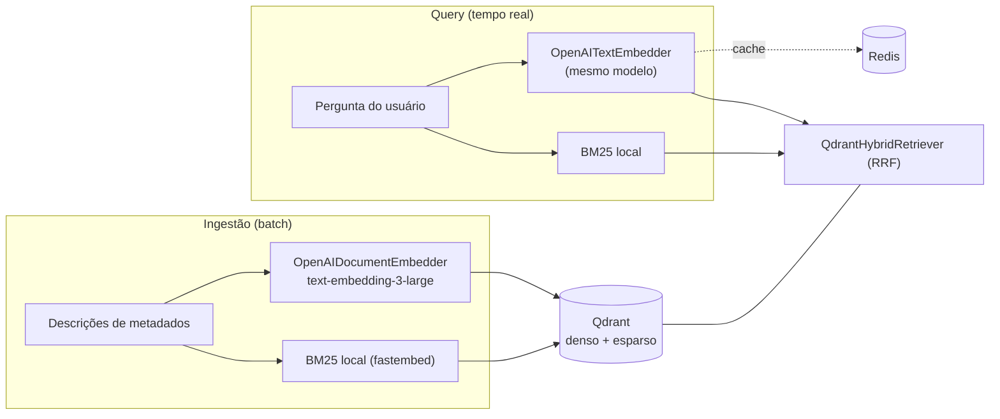

# ADR-0009: Modelo de embedding gerenciado (OpenAI) e composição do retrieval híbrido

- **Status**: Proposto
- **Data**: 2026-07-23
- **Autores**: Davi (graphrag-tais)
- **Revisores**: -

## Introdução ao problema

O [ADR-0003](./0003-qdrant-como-vector-store.md) escolheu o Qdrant e a recuperação
híbrida (denso + esparso), mas deixou explícito que **como** o Qdrant é consultado
— o modelo de embedding e a composição do híbrido — seria decidido em ADR próprio.
Este ADR cumpre essa pendência.

O scaffold usa hoje, por *default* de configuração, modelos **on-prem e de
inglês**: denso `nomic-embed-text` (Ollama) e esparso `prithivida/Splade_PP_en_v1`
(fastembed). Dois problemas convergem:

1. **Caminho crítico.** O embedding da **query** acontece em tempo real, a cada
   pergunta. O modelo on-prem é **lento na infra atual e pode ficar fora do ar**,
   degradando ou derrubando **toda** consulta do usuário.
2. **Idioma.** Ambos os modelos são treinados em **inglês**, sobre dado e
   perguntas em **português (PT-BR)** — o que compromete o recall (o SPLADE
   inglês, em particular, expande termos no vocabulário errado).

Como indexação e query **têm obrigatoriamente que usar o mesmo modelo** (senão os
vetores não vivem no mesmo espaço e não são comparáveis), a escolha vale para os
dois lados de uma vez. E precisa ser decidida **agora**, *upfront*: trocar o
modelo depois obriga **re-indexar todo o corpus**. Restrição herdada: LGPD /
on-prem, enfatizada nos ADRs anteriores
([ADR-0004](./0004-openmetadata-como-fonte-de-metadados.md)).

## Decisão

O embedding **denso** passa a ser um modelo **gerenciado da OpenAI** —
`text-embedding-3-large` — usado **igual na ingestão e na query**. O híbrido é
**mantido**, com o **esparso** provido por **BM25 local** (via fastembed,
`Qdrant/bm25`), substituindo o SPLADE inglês. Isso implica enviar à OpenAI
**descrições de metadados** (na ingestão) e **perguntas dos usuários** (na query)
— **nunca o dado das linhas** —, uma **divergência consciente** do on-prem dos
ADRs anteriores, **condicionada a sign-off de governança/LGPD**.

Regras da decisão:

1. **Denso = OpenAI `text-embedding-3-large`**, via `OpenAIDocumentEmbedder`
   (ingestão) e `OpenAITextEmbedder` (query) — **o mesmo modelo nos dois**. Motivo:
   alta disponibilidade e baixa latência no caminho crítico, e multilíngue (PT-BR)
   — o que o on-prem atual não entrega. O parâmetro `dimensions` (Matryoshka) pode
   encurtar o vetor (ex.: 1536 ou 1024) para economizar storage com perda modesta;
   a dimensão escolhida vira `QDRANT_EMBEDDING_DIM` e a coleção é recriada.
2. **Esparso = BM25 local** (`Qdrant/bm25` via fastembed), no lugar do
   `Splade_PP_en_v1`. BM25 é lexical (TF-IDF), roda **local** (sem custo de
   disponibilidade) e é **agnóstico a idioma** — casa identificadores exatos
   (nomes de coluna, códigos) em PT sem o viés inglês do SPLADE. O
   `QdrantHybridRetriever` (fusão RRF) permanece inalterado.
3. **Mesmo modelo nos dois lados é invariante.** Qualquer troca futura de modelo
   (denso ou esparso) exige **re-index total** — é uma operação, não um *toggle*.
4. **O que sai da infra.** Na ingestão: as **descrições dos metadados**
   (tabela/coluna/métrica/glossário). Na query: a **pergunta do usuário**. **As
   linhas do banco não saem** — elas só são tocadas na execução do SQL, que é
   on-prem ([ADR-0008](./0008-execucao-do-sql-e-visualizacao-no-v1.md)). Sign-off
   de governança/LGPD é **pré-requisito** para subir com dado real, e a política de
   retenção da API (dados de API não são usados para treino por padrão) fica
   registrada.
5. **Resiliência.** Como passa a haver dependência externa a cada query: `timeout`
   + `retry` no embedder da query, e **cache do embedding da query no Redis**
   (já provisionado, mesmo padrão do cache da IR do
   [ADR-0007](./0007-fechamento-dos-gaps-de-correcao-e-consistencia-do-v1.md)) —
   pergunta repetida não re-bate na API.

## Alternativas consideradas

### Alternativa A: Manter on-prem, trocando por um modelo multilíngue (ex.: BGE-M3)

- Descrição: resolver o **idioma** sem sair da infra, adotando um modelo
  multilíngue self-hosted (BGE-M3 entrega denso + esparso num modelo só).
- Prós: mantém on-prem/LGPD; um único modelo cobre denso e esparso.
- Contras: **não resolve o problema que motivou a decisão** — a latência e a
  instabilidade da infra on-prem no caminho crítico de toda query. Fica registrada
  como o **caminho de volta** ("plano B") se/quando a infra suportar ou a
  governança exigir on-prem.

### Alternativa B: OpenAI denso + BM25 esparso (escolhida)

- Descrição: denso gerenciado (HA, multilíngue) + esparso lexical local.
- Por que foi escolhida: resolve **disponibilidade** e **idioma** no caminho
  crítico; o BM25 local resolve o esparso PT sem reintroduzir dependência pesada; e
  é **mudança mínima** (mesma família de componentes, só troca de modelo/provedor).

### Alternativa C: OpenAI denso-only (abrir mão do esparso)

- Descrição: só o denso da OpenAI, sem componente esparso.
- Prós: mais simples (uma API só).
- Contras: perde o **match exato de identificador** (nome de coluna, código) —
  perda real para text-to-SQL; contraria o híbrido do ADR-0003.

### Alternativa D: Outro provedor gerenciado (Cohere, Voyage, Gemini)

- Descrição: outro embedding multilíngue gerenciado.
- Prós: também alta disponibilidade e multilíngue.
- Contras: nenhum ganho decisivo para o caso; OpenAI tem integração direta no
  Haystack. A decisão que importa é **"gerenciado de alta disponibilidade"** — a
  marca é trocável.

### Não fazer nada / manter status quo

- Descrição: seguir com os modelos ingleses on-prem.
- Por que não: recall ruim em PT **e** latência/instabilidade em toda query — junta
  as duas dores. Inaceitável para o v1.

## Tradeoffs

### Vantagens

- **[Alto impacto]** Tira o embedding do caminho crítico da infra on-prem
  (lenta/instável) → **latência e disponibilidade** melhores em toda query.
- **[Alto impacto]** Multilíngue **PT-BR de verdade** (denso) — recall melhor que
  o `nomic`/`SPLADE` ingleses.
- **[Médio impacto]** BM25 local resolve o esparso PT e **remove** um modelo
  (SPLADE) da operação; mudança mínima de código.
- **[Médio impacto]** `dimensions` (Matryoshka) permite equilibrar
  qualidade × storage.

### Desvantagens

- **[Alto impacto]** **Divergência do on-prem/LGPD**: metadados (ingestão) e
  perguntas (query) saem para a OpenAI. Mitigada por: **as linhas não saem**,
  sign-off de governança, política de retenção, e o caminho de volta (Alternativa A)
  registrado.
- **[Alto impacto]** **Dependência externa no caminho crítico**: OpenAI fora do ar
  ou com rate-limit derruba a query. Mitigada por `timeout`+`retry` e cache de
  embedding no Redis; a ingestão é batch (tolera).
- **[Médio impacto]** **Custo por chamada** (ingestão em lote + toda query) —
  controlável com `text-embedding-3-small`/`dimensions` e o cache.
- **[Baixo impacto]** **Re-index obrigatório** (nova dimensão) e ajuste de
  `QDRANT_EMBEDDING_DIM`.

### Avaliação

Os ganhos superam os custos para o v1: confiabilidade/latência no caminho crítico e
o multilíngue são exatamente o que o sistema precisa, e o on-prem atual não entrega
nenhum dos dois. A divergência do LGPD é real, mas **condicionada a sign-off**, com
o escopo do que sai **explícito** (metadado + pergunta, nunca linhas) e um
**caminho de volta** documentado (BGE-M3 on-prem). Riscos ativos: (1) governança
pode barrar o envio → cai-se na Alternativa A; (2) dependência externa → mitigada
por cache e retry.

## Consequências

- **Positivas**: retrieval multilíngue e de baixa latência; esparso PT resolvido
  (BM25 agnóstico a idioma); menos um modelo on-prem pesado para operar.
- **Negativas**: dado (metadado + pergunta) sai para a nuvem (dívida de
  governança); custo por chamada; dependência externa a cada query; re-index total.
- **Ações decorrentes**:
  - Trocar os embedders densos: `Ollama*Embedder` → `OpenAIDocumentEmbedder` /
    `OpenAITextEmbedder` (`text-embedding-3-large`, `dimensions` a definir). Envs:
    `OPENAI_API_KEY`, `OPENAI_EMBED_MODEL`, `EMBED_DIMENSIONS`.
  - Trocar o esparso: `QDRANT_SPARSE_MODEL` de `prithivida/Splade_PP_en_v1` para
    `Qdrant/bm25`.
  - Recriar a coleção Qdrant com a nova `QDRANT_EMBEDDING_DIM` e **re-ingestão
    total**.
  - Implementar **cache de embedding de query no Redis** + `timeout`/`retry` no
    embedder.
  - Obter **sign-off de governança/LGPD** antes de subir com dado real; registrar a
    política de retenção da OpenAI.
  - Manter registrado o **caminho de volta on-prem (BGE-M3)** como plano B.
  - Fica **em aberto** (ADR futuro de *tuning* de recuperação): `top_k`, **quotas
    por tipo de card** (ideia levantada no
    [ADR-0006](./0006-interpretacao-da-pergunta-em-representacao-estruturada.md)) e
    um eventual reranker.

## Referências

- [ADR-0001: GraphRAG como estratégia de recuperação](./0001-graphrag-como-estrategia-de-recuperacao.md)
- [ADR-0003: Qdrant como vector store da camada semântica](./0003-qdrant-como-vector-store.md)
- [ADR-0004: OpenMetadata como fonte de metadados e ingestão determinística](./0004-openmetadata-como-fonte-de-metadados.md)
- [ADR-0007: Fechamento dos gaps de correção e consistência do v1](./0007-fechamento-dos-gaps-de-correcao-e-consistencia-do-v1.md)
- [ADR-0008: Execução do SQL e visualização no v1](./0008-execucao-do-sql-e-visualizacao-no-v1.md)
- [Haystack — OpenAITextEmbedder](https://docs.haystack.deepset.ai/docs/openaitextembedder) · [OpenAIDocumentEmbedder](https://docs.haystack.deepset.ai/docs/openaidocumentembedder)
- [OpenAI — Embeddings v3 (multilíngue, `dimensions`)](https://developers.openai.com/api/docs/guides/embeddings)
- [fastembed — BM25 esparso](https://github.com/qdrant/fastembed/blob/main/fastembed/sparse/bm25.py) · [Qdrant — Hybrid Queries](https://qdrant.tech/documentation/concepts/hybrid-queries/)
- [MTEB-BR — benchmark de embeddings em português do Brasil](https://arxiv.org/html/2607.04581v2)
