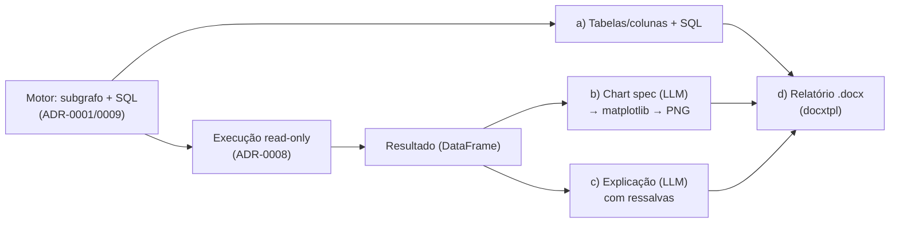

# ADR-0010: Camada de entrega — das tabelas ao relatório (a, b, c, d)

- **Status**: Aceito — itens (a), (b) e (d) implementados até 2026-08-10 e **(c) em
  2026-08-21** (ver as "Atualizações de implementação" no fim)
- **Data**: 2026-07-23
- **Autores**: Davi (graphrag-tais)
- **Revisores**: -

## Introdução ao problema

O motor de recuperação + SQL está definido (recuperação em duas camadas,
[ADR-0001](./0001-graphrag-como-estrategia-de-recuperacao.md); embedding/híbrido,
[ADR-0009](./0009-modelo-de-embedding-e-composicao-do-retrieval-hibrido.md)) e a
**execução** do SQL com plotagem base já foi decidida
([ADR-0008](./0008-execucao-do-sql-e-visualizacao-no-v1.md)). Mas o **produto** —
o assistente de descoberta de dados — não entrega "um SQL": ele entrega, por
pergunta, **quatro coisas**:

- **a)** as **bases/tabelas/colunas** relevantes à pergunta;
- **b)** um **gráfico** automático do indicador;
- **c)** uma **explicação textual** do dado/gráfico;
- **d)** um **relatório** (`.docx`) consolidando tudo.

Hoje o fluxo para no SQL (item **a** parcialmente, via subgrafo recuperado). Falta
**definir os passos da camada de entrega** — o que cada um dos quatro produz, com
que insumo, em que ordem, e onde é orquestrado. Precisa ser decidido agora porque
é o que fecha o produto; sem isso, o motor não vira assistente. Restrições
herdadas: LGPD (o que trafega para o LLM/nuvem) e o fato de o **modelo detalhado do
grafo** (grain, joinabilidade) ter sido **adiado** — o que limita a *correção
semântica* das saídas e precisa aparecer honestamente na entrega.

## Decisão

A entrega é uma **pipeline própria** (Haystack) que **compõe** a saída do motor
(subgrafo + SQL) e o **resultado executado** ([ADR-0008](./0008-execucao-do-sql-e-visualizacao-no-v1.md))
em **quatro estágios**. O motor (recuperação + SQL) permanece **reusável e
inalterado**; a entrega o consome.

Os quatro estágios:

1. **a) Contexto de dados.** Expõe, como saída **estruturada**, as tabelas/colunas
   do subgrafo recuperado (`Neo4jSubgraphRetriever`) — com origem e descrição — mais
   o **SQL** gerado. Já é produzido pelo motor; a entrega apenas o **formaliza** como
   parte da resposta.
2. **b) Gráfico.** Sobre o DataFrame executado, um **LLM emite uma *chart spec*
   estruturada** (tipo de gráfico, eixo x, eixo y, série) — **validada contra as
   colunas reais** do DataFrame — e o **matplotlib renderiza de forma
   determinística → PNG** ([ADR-0008](./0008-execucao-do-sql-e-visualizacao-no-v1.md)).
   A escolha do gráfico é guiada pela **intenção da IR**
   ([ADR-0006](./0006-interpretacao-da-pergunta-em-representacao-estruturada.md):
   `aggregate`/`trend`/`compare`…) + tipos/cardinalidade das colunas do resultado.
   *Fallback*: resultado que não vira gráfico (ex.: escalar único) → mostra o
   número/tabela. **O LLM escolhe, não desenha** — o desenho é determinístico.
3. **c) Explicação.** Um LLM gera o texto de análise. Insumo: a **IR** (o que foi
   pedido) + o **SQL** + o **subgrafo** (descrições de tabela/coluna e definição da
   métrica) + um **resumo do resultado** (forma, estatísticas-chave — **não** as
   linhas cruas). *Guardrails*: ancorar nos números reais (não inventar), **citar as
   tabelas-fonte**, e **declarar cuidados de interpretação** — incluindo,
   explicitamente, a **ressalva de granularidade** enquanto o grafo não modelar
   `grain` (ver Limitação, abaixo).
4. **d) Relatório `.docx`.** Monta **a + b + c** num **template `.docx`
   pré-montado** via **`docxtpl`** (Jinja2 dentro do Word + `InlineImage` para
   embutir o PNG do gráfico). Saída: um artefato `.docx` para download.

**Renderers do gráfico (reuso de código interno).** O passo (b) é uma **biblioteca
de renderers por tipo** — barra horizontal (com rótulo de valor), série temporal
(linha + área) e wordcloud (coluna textual) —, cada um **parametrizado pelas
colunas** vindas da *chart spec* (não acoplado a colunas de domínio fixo). Um
**helper de estilo** compartilhado (remoção de spines, grid, paleta, `dpi=300`,
`bbox_inches="tight"`) garante identidade visual consistente. Cada renderer devolve,
além do PNG, **estatísticas-chave** (ex.: maior categoria e seu valor) que
**alimentam a explicação (c)**. Essa biblioteca **adapta um conjunto de funções de
plotagem já existente internamente** (o padrão `DataFrame → matplotlib → PNG`),
**descartando** o acoplamento à busca de dados por domínio — aqui o dado vem do SQL
executado.

**Armazenamento e download (d).** O PNG **embutido no docx** (via `InlineImage`)
**não precisa** de hosting próprio; só a eventual exibição *inline* no chat exigiria
(base64 ou URL). O `.docx` é hospedado em **object storage (MinIO, já disponível no
projeto)** e entregue por **URL assinada/expirável** — como o link chega à UI é da
camada de serving (futura).

**Saída da entrega** = um objeto estruturado `{a: tabelas/colunas+SQL, b: PNG,
c: texto, d: docx}`. **Como cada artefato chega à interface** (texto em streaming,
imagem, link de download) é responsabilidade da camada de **serving** — decisão
própria, futura.

**Limitação registrada (honestidade).** Como o modelo detalhado do grafo
(grain/joinabilidade) foi **adiado**, b/c/d apresentam resultados cuja **correção
semântica não é garantida** (ex.: `COUNT` com fan-out). A explicação (c) **carrega
essa ressalva**; é limitação conhecida — não escondida —, apontando para o ADR
futuro do grafo. (Mesma postura do [ADR-0007](./0007-fechamento-dos-gaps-de-correcao-e-consistencia-do-v1.md):
validação *estrutural* não é *semântica*.)

## Alternativas consideradas

### b) Gráfico: LLM desenha vs *chart spec* estruturada (escolhida)

- Descrição: alternativa seria o LLM gerar o código/imagem do gráfico.
- Por que a spec: o LLM **escolhendo** (tipo + eixos) e o matplotlib **desenhando**
  dá saída **previsível e testável**, sem o LLM emitir código arbitrário. Heurística
  pura por dtype foi considerada, mas perde o sinal da intenção (IR).
- *Tool-per-chart* (o LLM-agente chama uma tool por tipo de gráfico, como no código
  interno de referência) também foi avaliado: funciona, mas amarra os tipos a tools
  nomeadas e depende de *tool-calling*. A *chart spec* + dispatcher é mais constrita e
  consistente com a saída estruturada já usada na IR
  ([ADR-0006](./0006-interpretacao-da-pergunta-em-representacao-estruturada.md)).

### c) Explicação: linhas cruas vs resumo do resultado (escolhida)

- Alimentar o LLM com as **linhas cruas** daria mais detalhe, mas **vaza dado** para
  o LLM/nuvem (LGPD) e gasta tokens. O **resumo** (forma + estatísticas) preserva a
  privacidade e basta para a análise. "Sem explicação" não atende o item **c**.

### d) Relatório: `docxtpl` (escolhida) vs `python-docx` puro vs outro formato

- `python-docx` puro exige montar o layout em código (sem template editável).
- `docxtpl` deixa o **template no Word** (não-devs editam) e embute imagem via
  `InlineImage`. Outros formatos (PDF/HTML) fogem do briefing, que pede **docx**.

### Orquestração: pipeline de entrega separada (escolhida) vs tudo na pipeline de query

- Colocar a/b/c/d **dentro** da pipeline de query **acopla** o motor à entrega e
  quebra o reuso (o motor deve servir qualquer consumidor, não só este produto).
  Entrega como **pipeline separada** que compõe o motor preserva a genericidade.

### Não fazer nada / manter status quo

- Entregar só o SQL: os itens **b/c/d** ficam de fora — não é o produto.

## Tradeoffs

### Vantagens

- **[Alto impacto]** Fecha o produto (as quatro entregas do briefing) **reusando**
  o motor e a execução ([ADR-0008](./0008-execucao-do-sql-e-visualizacao-no-v1.md)).
- **[Alto impacto]** *Chart spec* estruturada + render determinístico → gráfico
  **previsível e testável** (o LLM escolhe, não desenha).
- **[Médio impacto]** `docxtpl` deixa o template **editável no Word**; `InlineImage`
  embute o PNG — baixo atrito para ajustar o layout do relatório.
- **[Médio impacto]** Explicação ancorada no resultado real + **resumo** (não linhas
  cruas) respeita LGPD e economiza tokens.
- **[Médio impacto]** Motor permanece **reusável** (entrega é pipeline separada).

### Desvantagens

- **[Alto impacto]** **Correção semântica não garantida** (grain adiado): b/c/d
  podem apresentar número com fan-out. Mitigada pela **ressalva explícita** na
  explicação, mas é limitação real até o ADR do grafo.
- **[Médio impacto]** Duas chamadas de LLM a mais no caminho (*chart spec* +
  explicação; a IR já existe) — latência/custo; mitigável (explicação pode ser
  *streamada*; a *chart spec* é curta).
- **[Médio impacto]** Superfície nova: construtor de *chart spec*, renderers,
  explicador, construtor de relatório e o template `.docx` — **parcialmente mitigada**
  pelo reuso do código de plotagem interno já existente.
- **[Baixo impacto]** Dependência de `docxtpl` (o matplotlib já entra pelo
  [ADR-0008](./0008-execucao-do-sql-e-visualizacao-no-v1.md)).

### Avaliação

Os ganhos superam os custos: é o que **transforma o motor em produto**, e cada
estágio reusa peças já decididas. A maior desvantagem — correção semântica — é
**herdada do adiamento** do modelo do grafo, não criada aqui, e fica **visível**
(ressalva na explicação), não escondida. Risco ativo: a ressalva de granularidade
precisa ser real e legível na resposta, para não gerar falsa confiança — some
quando o ADR do grafo entrar.

## Consequências

- **Positivas**: o produto fecha (a/b/c/d); saídas estruturadas e testáveis;
  template de relatório editável por não-devs.
- **Negativas**: correção semântica pendente (grain); mais LLM no caminho;
  superfície nova de código.
- **Ações decorrentes**:
  - Implementar a **pipeline de entrega** (Haystack) compondo motor → execução
    ([ADR-0008](./0008-execucao-do-sql-e-visualizacao-no-v1.md)) → *chart spec* +
    matplotlib → explicação → `docxtpl`.
  - Componentes custom: `ChartSpecBuilder` (LLM, saída estruturada validada contra
    as colunas); uma **biblioteca de renderers por tipo** (barra/série/wordcloud,
    parametrizados por coluna) com **helper de estilo** compartilhado, retornando
    **PNG + estatísticas-chave** — adaptada do código de plotagem interno existente;
    `ResultExplainer` (LLM, resumo + guardrails, consumindo as estatísticas-chave);
    `ReportBuilder` (`docxtpl` + `InlineImage`); e o **template `.docx`**.
  - Hospedar o `.docx` em **MinIO** (já disponível) e servi-lo por **URL
    assinada/expirável**; o PNG embutido no docx dispensa hosting próprio.
  - A explicação (c) **deve** incluir a **ressalva de granularidade** enquanto o
    grafo não modelar `grain`.
  - Definir, na camada de **serving** (ADR futuro), **como** os quatro artefatos
    chegam à UI (texto em streaming, imagem, link de download do docx).
  - Novas dependências: `docxtpl` (e `wordcloud`, se mantido o renderer de nuvem de palavras).

## Atualização de implementação (2026-08-10)

O item **(d) relatório `.docx`** foi implementado, com **dois desvios** em relação
à decisão original acima. Registrados aqui por honestidade (a decisão de 2026-07-23
fica intacta como contexto histórico):

1. **Mecanismo: `python-docx` + tema aplicado por código, não `docxtpl`.** A decisão
   original previa `docxtpl` (Jinja dentro de um `.docx` pré-montado no Word). Na
   prática a entrada é **uma única string Markdown** (a mesma que vai ao OpenWebUI:
   explicação + SQL + dicionário de dados + JOINs + IR + **gráfico já embutido como
   PNG base64**), então o caminho mais simples e testável foi um **conversor
   Markdown→docx** (`components/report/docx_writer.py`) escrevendo num documento
   estilizado por código (`components/report/theme.py`): roxo `#7A34F3` nos títulos,
   Inter, capa com a logo oficial, tabelas zebradas com header roxo, blocos SQL
   monoespaçados. A identidade visual do GovHub só existe como CSS/HTML
   (`govhub-visual-identity`), não há asset `.docx` da marca — por isso é recriada em
   código, evitando manter um template Word binário à mão. O `InlineImage` do
   `docxtpl` vira `add_picture` a partir do base64 decodificado. Isso reaproveita a
   **resposta completa** do chat como fonte do relatório (o briefing "tudo que está na
   resposta entra no relatório").
2. **MinIO foi *adicionado* ao stack, não "já disponível".** A decisão dizia "MinIO
   (já disponível no projeto)" — **incorreto**: não havia serviço MinIO no
   `docker-compose.yaml` nem config. Foi adicionado agora (serviço `minio` + volume;
   `MinIOUploader` com `boto3`). **Gotcha registrado**: a URL assinada (SigV4) inclui
   o host; o upload usa o endpoint **interno** (`minio:9000`) mas a assinatura usa o
   endpoint **público** (`MINIO_PUBLIC_ENDPOINT`, ex. `localhost:9000`), senão o link
   quebra no navegador do usuário. Entrega: o `.docx` é enviado ao MinIO e o
   **link de download** (URL assinada/expirável) é **anexado ao Markdown** da resposta
   do chat, de forma **aditiva e defensiva** (se o MinIO estiver fora, devolve só o
   texto — mesmo padrão do gráfico).

**Atualização 2 (2026-08-10): montagem a partir do dado ESTRUTURADO, não do Markdown.**
A 1ª versão re-parseava a **string Markdown do chat** com um conversor caseiro
(`docx_writer.render_markdown`), o que deixava marcação crua no `.docx` (crases dentro
de negrito, `_itálico_` quebrado por underscores de identificadores como `api_ibge_uf`).
Corrigido montando o relatório direto do **`answer` estruturado** do motor (`explanation`,
`sql`, `references`, `ir`, `joins`) + o PNG do gráfico + status da execução
(`report_content.render_answer` → `ReportBuilder.build_from_answer`). Sem parsing de
Markdown = sem marcação crua, e cada seção é renderizada com controle total (badges do
tipo real da coluna, descrição em itálico direto, espaçamento enxuto). O conversor de
Markdown fica como **fallback**. O `_with_delivery` passou a devolver também os dados
estruturados da entrega (gráfico, sql_final, status), consumidos pelo relatório.

Componentes entregues: `components/report/{theme,docx_writer,report_content,report_builder}.py`
+ `assets/` (logo branca, símbolo, spacer), `components/storage/minio_uploader.py`, config em
`settings/configs.py` (bloco `REPORT_*`/`MINIO_*`), e o wiring em
`pipelines/query/pipeline_wrapper.py` (`_attach_report`). Deps novas: `python-docx`,
`boto3`. Pendente de validação end-to-end: round-trip real do upload/URL no `make up`.

## Atualização de implementação (2026-08-21) — item (c) entregue

O item **(c) explicação** foi implementado como `ResultExplainer`
(`components/answer/result_explainer.py`), componente da pipeline de entrega ligado às saídas
`rows`/`columns`/`exec_ok` do `McpSqlExecutor`. Ele produz **um parágrafo** que entra na seção
`### Resultado` do chat e numa seção "Resultado" do `.docx`, **imediatamente acima do gráfico**.

**Por que agora**: o gráfico chegava sozinho. Quem pergunta um indicador recebia explicação do
*caminho* (tabela escolhida, SQL), dicionário de dados e uma imagem — e nenhuma frase sobre o
**dado**. No resultado **escalar** (um `SUM`, sem gráfico nenhum) a resposta terminava sem o
número aparecer em texto em lugar algum.

**Fiel à decisão de 2026-07-23 no que importa**: o LLM **não recebe as linhas**. Recebe o
`digest` — texto determinístico montado em Python (`build_digest`) com contagem de linhas,
soma/média/mínimo/máximo por métrica, as `RESULT_SUMMARY_TOP_N` maiores categorias, as duas
menores e o começo/fim da série temporal. Isso mantém o argumento de LGPD/tokens da alternativa
escolhida e vira o **guardrail testável** da alucinação: o prompt proíbe citar número que não
esteja no digest, e o digest é fixado por teste (`tests/test_result_explainer.py`).

**Dois desvios, registrados por honestidade:**

1. **A ressalva de granularidade não é obrigatória em todo texto.** A decisão original mandava
   a explicação carregar sempre a ressalva de grain. Desde então o grão passou a ser
   **declarado** no card (`OM_GRAIN_KEYS`) e o prompt de geração de SQL obriga a deduplicar
   quando a tabela avisa que há linhas duplicadas — a mitigação migrou para *antes* do número
   existir. Somada à instrução de "1 parágrafo, 2 a 3 frases", uma ressalva fixa em toda
   resposta viraria ruído ignorável. Fica o risco conhecido: **onde o grão não estiver
   declarado, o número pode ter fan-out e o texto não avisa** (é o gap 4 do `CLAUDE.md`).
2. **O erro de execução não vira texto.** Se o SQL não roda, o componente devolve vazio e a
   seção some — mesma decisão de produto de 19/08 aplicada ao bloco de SQL. Consulta válida com
   **zero linhas** é diferente e ganha frase própria, determinística, sem chamar o modelo.

**A IR saiu da resposta renderizada.** O `answer` seguia imprimindo
`Interpretação (IR): intent … metric … filtros …` no chat e no `.docx`. É vocabulário de
engenharia ([ADR-0006](./0006-interpretacao-da-pergunta-em-representacao-estruturada.md) /
[ADR-0007](./0007-fechamento-dos-gaps-de-correcao-e-consistencia-do-v1.md)) e nenhum leitor da
Persona 2 faz nada com ele — enquanto ocupava a última linha da resposta, logo antes do gráfico,
que é onde agora entra a leitura do resultado. A IR **continua** no `answer` de `/query/run`, no
log e alimentando a escolha do gráfico: o ponto de controle inspecionável está preservado, o que
mudou foi só **quem é o público** de cada saída.

Config nova (`settings/configs.py` + `.env.example`): `RESULT_SUMMARY_ENABLED` (default `true`),
`RESULT_SUMMARY_MAX_TOKENS` (260), `RESULT_SUMMARY_TOP_N` (5). Custo medido na resposta completa
do chat: sem diferença perceptível de latência (≈7s antes e depois, numa pergunta por UF).

**Round-trip do (d) validado** (estava pendente desde 2026-08-10): o `.docx` foi baixado pelo
link assinado do MinIO e conferido em PDF (LibreOffice) — capa em 1 página, seções na ordem
explicação → SQL executado → dados de referência → Resultado → Gráfico.

## Atualização de implementação (2026-08-27) — o download passa pelo RAG, não pelo MinIO

**O que quebrou.** A entrega do `.docx` (e do CSV de amostra, ADR-0015) era uma **URL assinada
do MinIO**. Isso só funciona quando o navegador do usuário alcança o MinIO — verdade em dev
(`localhost:9000`), **falso em produção**: lá o `minio` vive na rede privada do compose, sem
porta publicada e sem domínio. E como a assinatura SigV4 **embute o host**, não havia como
"consertar o link": qualquer host que o navegador alcançasse invalidaria a assinatura. Quem tem
URL pública é o **RAG**.

**Decisão.** O RAG serve o arquivo. `GET /files/{bucket}/{objeto}?exp=…&sig=…`
(`src/rag/server/downloads.py`) lê o objeto pelo endpoint **interno** do MinIO e o repassa ao
navegador como `attachment`. A requisição do navegador nunca toca o MinIO.

Perdida a assinatura do S3, o link ganha uma **própria**: HMAC-SHA256 de
`(bucket, objeto, expiração)` em `components/storage/download_links.py` — sem ela, `/files`
seria leitura anônima de bucket. A semântica de antes é preservada: link **opaco e expirável**,
com a validade continuando nas mesmas configs (`REPORT_PRESIGN_EXPIRY` 7 dias,
`SAMPLE_PRESIGN_EXPIRY` 15 min — o nome ficou por estabilidade do `.env`). A expiração entra no
HMAC, então esticar o `exp` na URL não estende prazo nenhum. Assinatura inválida → **403**,
vencida → **410**, bucket fora do par publicado (`relatorios`, `amostras`) → **404**. A chave é
`DOWNLOAD_SIGNING_KEY`; vazia, cai na `MINIO_SECRET_KEY` (segredo do mesmo domínio — quem a tem
já lê o bucket inteiro), para não obrigar mais uma variável no `.env`.

**Config**: entra `PUBLIC_BASE_URL` (a URL pública do RAG, que é a base do link — em produção,
o domínio real) e **sai `MINIO_PUBLIC_ENDPOINT`**, que existia só para assinar contra um host
externo. `MINIO_ENDPOINT` (interno) passa a servir upload **e** leitura, num client só.

**Consequência no boot** (o custo desta decisão): o Hayhooks não expõe gancho para rota custom —
`create_app()` devolve um app novo a cada chamada, sem hook de extensão. Então o compose deixa de
subir `hayhooks run` e passa a subir `uvicorn rag.server.app:create_app --factory`, onde
`src/rag/server/app.py` é o app do Hayhooks **mais** as rotas do projeto. É a mesma execução que
o `hayhooks run --reload` faz por baixo (ele próprio chama
`uvicorn hayhooks.server.app:create_app --factory`); o que era flag de CLI vira env
(`HAYHOOKS_PIPELINES_DIR`, `HAYHOOKS_ADDITIONAL_PYTHON_PATH`, `PYTHONPATH=/app/src`), que é como
o CLI já propagava para os workers. Nenhuma rota do Hayhooks muda.

**Alternativas descartadas.** (a) *Publicar o MinIO com domínio próprio*: mais superfície
pública, mais TLS/DNS para operar, e a assinatura SigV4 continuaria acoplada ao host. (b)
*Repassar a URL assinada por dentro do proxy*: preserva o SigV4, mas herda a fragilidade dele
(qualquer reescrita de query string quebra a assinatura) sem ganho nenhum sobre o HMAC próprio.
(c) *Deixar o objeto público no bucket*: não expira e não tem dono — inviável para a amostra,
que carrega **linhas reais** do banco.

**Verificado end-to-end** (RAG + MinIO em rede isolada, sem porta do MinIO publicada): download
200 com `Content-Disposition: attachment` e `Content-Length` correto; assinatura adulterada 403;
`exp` esticado 403; link vencido 410; bucket desconhecido 404; objeto inexistente 404.
Testes offline da assinatura em `tests/test_download_links.py` (11 casos, rodam no host).

## Referências

- [ADR-0001: GraphRAG como estratégia de recuperação](./0001-graphrag-como-estrategia-de-recuperacao.md)
- [ADR-0006: Interpretação da pergunta em uma representação estruturada (IR)](./0006-interpretacao-da-pergunta-em-representacao-estruturada.md)
- [ADR-0007: Fechamento dos gaps de correção e consistência do v1](./0007-fechamento-dos-gaps-de-correcao-e-consistencia-do-v1.md)
- [ADR-0008: Execução do SQL e visualização no v1](./0008-execucao-do-sql-e-visualizacao-no-v1.md)
- [ADR-0009: Modelo de embedding e composição do retrieval híbrido](./0009-modelo-de-embedding-e-composicao-do-retrieval-hibrido.md)
- [docxtpl — Word como template Jinja2 (`InlineImage`)](https://docxtpl.readthedocs.io/)
- [matplotlib](https://matplotlib.org/)
