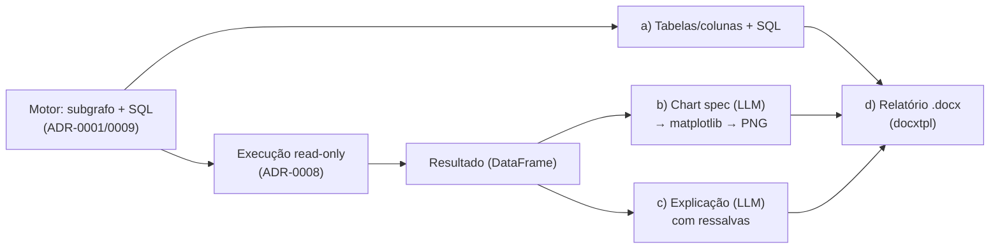

# ADR-0010: Camada de entrega — das tabelas ao relatório (a, b, c, d)

- **Status**: Proposto
- **Data**: 2026-07-23
- **Autores**: Davi (graphrag-tais)
- **Revisores**: -

## Introdução ao problema

O motor de recuperação + SQL está definido (recuperação em duas camadas,
[ADR-0001](./0001-graphrag-como-estrategia-de-recuperacao.md); embedding/híbrido,
[ADR-0009](./0009-modelo-de-embedding-e-composicao-do-retrieval-hibrido.md)) e a
**execução** do SQL com plotagem base já foi decidida
([ADR-0008](./0008-execucao-do-sql-e-visualizacao-no-v1.md)). Mas o **produto** —
o assistente de descoberta de dados — não entrega "um SQL": ele entrega, por
pergunta, **quatro coisas**:

- **a)** as **bases/tabelas/colunas** relevantes à pergunta;
- **b)** um **gráfico** automático do indicador;
- **c)** uma **explicação textual** do dado/gráfico;
- **d)** um **relatório** (`.docx`) consolidando tudo.

Hoje o fluxo para no SQL (item **a** parcialmente, via subgrafo recuperado). Falta
**definir os passos da camada de entrega** — o que cada um dos quatro produz, com
que insumo, em que ordem, e onde é orquestrado. Precisa ser decidido agora porque
é o que fecha o produto; sem isso, o motor não vira assistente. Restrições
herdadas: LGPD (o que trafega para o LLM/nuvem) e o fato de o **modelo detalhado do
grafo** (grain, joinabilidade) ter sido **adiado** — o que limita a *correção
semântica* das saídas e precisa aparecer honestamente na entrega.

## Decisão

A entrega é uma **pipeline própria** (Haystack) que **compõe** a saída do motor
(subgrafo + SQL) e o **resultado executado** ([ADR-0008](./0008-execucao-do-sql-e-visualizacao-no-v1.md))
em **quatro estágios**. O motor (recuperação + SQL) permanece **reusável e
inalterado**; a entrega o consome.

Os quatro estágios:

1. **a) Contexto de dados.** Expõe, como saída **estruturada**, as tabelas/colunas
   do subgrafo recuperado (`Neo4jSubgraphRetriever`) — com origem e descrição — mais
   o **SQL** gerado. Já é produzido pelo motor; a entrega apenas o **formaliza** como
   parte da resposta.
2. **b) Gráfico.** Sobre o DataFrame executado, um **LLM emite uma *chart spec*
   estruturada** (tipo de gráfico, eixo x, eixo y, série) — **validada contra as
   colunas reais** do DataFrame — e o **matplotlib renderiza de forma
   determinística → PNG** ([ADR-0008](./0008-execucao-do-sql-e-visualizacao-no-v1.md)).
   A escolha do gráfico é guiada pela **intenção da IR**
   ([ADR-0006](./0006-interpretacao-da-pergunta-em-representacao-estruturada.md):
   `aggregate`/`trend`/`compare`…) + tipos/cardinalidade das colunas do resultado.
   *Fallback*: resultado que não vira gráfico (ex.: escalar único) → mostra o
   número/tabela. **O LLM escolhe, não desenha** — o desenho é determinístico.
3. **c) Explicação.** Um LLM gera o texto de análise. Insumo: a **IR** (o que foi
   pedido) + o **SQL** + o **subgrafo** (descrições de tabela/coluna e definição da
   métrica) + um **resumo do resultado** (forma, estatísticas-chave — **não** as
   linhas cruas). *Guardrails*: ancorar nos números reais (não inventar), **citar as
   tabelas-fonte**, e **declarar cuidados de interpretação** — incluindo,
   explicitamente, a **ressalva de granularidade** enquanto o grafo não modelar
   `grain` (ver Limitação, abaixo).
4. **d) Relatório `.docx`.** Monta **a + b + c** num **template `.docx`
   pré-montado** via **`docxtpl`** (Jinja2 dentro do Word + `InlineImage` para
   embutir o PNG do gráfico). Saída: um artefato `.docx` para download.

**Renderers do gráfico (reuso de código interno).** O passo (b) é uma **biblioteca
de renderers por tipo** — barra horizontal (com rótulo de valor), série temporal
(linha + área) e wordcloud (coluna textual) —, cada um **parametrizado pelas
colunas** vindas da *chart spec* (não acoplado a colunas de domínio fixo). Um
**helper de estilo** compartilhado (remoção de spines, grid, paleta, `dpi=300`,
`bbox_inches="tight"`) garante identidade visual consistente. Cada renderer devolve,
além do PNG, **estatísticas-chave** (ex.: maior categoria e seu valor) que
**alimentam a explicação (c)**. Essa biblioteca **adapta um conjunto de funções de
plotagem já existente internamente** (o padrão `DataFrame → matplotlib → PNG`),
**descartando** o acoplamento à busca de dados por domínio — aqui o dado vem do SQL
executado.

**Armazenamento e download (d).** O PNG **embutido no docx** (via `InlineImage`)
**não precisa** de hosting próprio; só a eventual exibição *inline* no chat exigiria
(base64 ou URL). O `.docx` é hospedado em **object storage (MinIO, já disponível no
projeto)** e entregue por **URL assinada/expirável** — como o link chega à UI é da
camada de serving (futura).

**Saída da entrega** = um objeto estruturado `{a: tabelas/colunas+SQL, b: PNG,
c: texto, d: docx}`. **Como cada artefato chega à interface** (texto em streaming,
imagem, link de download) é responsabilidade da camada de **serving** — decisão
própria, futura.

**Limitação registrada (honestidade).** Como o modelo detalhado do grafo
(grain/joinabilidade) foi **adiado**, b/c/d apresentam resultados cuja **correção
semântica não é garantida** (ex.: `COUNT` com fan-out). A explicação (c) **carrega
essa ressalva**; é limitação conhecida — não escondida —, apontando para o ADR
futuro do grafo. (Mesma postura do [ADR-0007](./0007-fechamento-dos-gaps-de-correcao-e-consistencia-do-v1.md):
validação *estrutural* não é *semântica*.)

## Alternativas consideradas

### b) Gráfico: LLM desenha vs *chart spec* estruturada (escolhida)

- Descrição: alternativa seria o LLM gerar o código/imagem do gráfico.
- Por que a spec: o LLM **escolhendo** (tipo + eixos) e o matplotlib **desenhando**
  dá saída **previsível e testável**, sem o LLM emitir código arbitrário. Heurística
  pura por dtype foi considerada, mas perde o sinal da intenção (IR).
- *Tool-per-chart* (o LLM-agente chama uma tool por tipo de gráfico, como no código
  interno de referência) também foi avaliado: funciona, mas amarra os tipos a tools
  nomeadas e depende de *tool-calling*. A *chart spec* + dispatcher é mais constrita e
  consistente com a saída estruturada já usada na IR
  ([ADR-0006](./0006-interpretacao-da-pergunta-em-representacao-estruturada.md)).

### c) Explicação: linhas cruas vs resumo do resultado (escolhida)

- Alimentar o LLM com as **linhas cruas** daria mais detalhe, mas **vaza dado** para
  o LLM/nuvem (LGPD) e gasta tokens. O **resumo** (forma + estatísticas) preserva a
  privacidade e basta para a análise. "Sem explicação" não atende o item **c**.

### d) Relatório: `docxtpl` (escolhida) vs `python-docx` puro vs outro formato

- `python-docx` puro exige montar o layout em código (sem template editável).
- `docxtpl` deixa o **template no Word** (não-devs editam) e embute imagem via
  `InlineImage`. Outros formatos (PDF/HTML) fogem do briefing, que pede **docx**.

### Orquestração: pipeline de entrega separada (escolhida) vs tudo na pipeline de query

- Colocar a/b/c/d **dentro** da pipeline de query **acopla** o motor à entrega e
  quebra o reuso (o motor deve servir qualquer consumidor, não só este produto).
  Entrega como **pipeline separada** que compõe o motor preserva a genericidade.

### Não fazer nada / manter status quo

- Entregar só o SQL: os itens **b/c/d** ficam de fora — não é o produto.

## Tradeoffs

### Vantagens

- **[Alto impacto]** Fecha o produto (as quatro entregas do briefing) **reusando**
  o motor e a execução ([ADR-0008](./0008-execucao-do-sql-e-visualizacao-no-v1.md)).
- **[Alto impacto]** *Chart spec* estruturada + render determinístico → gráfico
  **previsível e testável** (o LLM escolhe, não desenha).
- **[Médio impacto]** `docxtpl` deixa o template **editável no Word**; `InlineImage`
  embute o PNG — baixo atrito para ajustar o layout do relatório.
- **[Médio impacto]** Explicação ancorada no resultado real + **resumo** (não linhas
  cruas) respeita LGPD e economiza tokens.
- **[Médio impacto]** Motor permanece **reusável** (entrega é pipeline separada).

### Desvantagens

- **[Alto impacto]** **Correção semântica não garantida** (grain adiado): b/c/d
  podem apresentar número com fan-out. Mitigada pela **ressalva explícita** na
  explicação, mas é limitação real até o ADR do grafo.
- **[Médio impacto]** Duas chamadas de LLM a mais no caminho (*chart spec* +
  explicação; a IR já existe) — latência/custo; mitigável (explicação pode ser
  *streamada*; a *chart spec* é curta).
- **[Médio impacto]** Superfície nova: construtor de *chart spec*, renderers,
  explicador, construtor de relatório e o template `.docx` — **parcialmente mitigada**
  pelo reuso do código de plotagem interno já existente.
- **[Baixo impacto]** Dependência de `docxtpl` (o matplotlib já entra pelo
  [ADR-0008](./0008-execucao-do-sql-e-visualizacao-no-v1.md)).

### Avaliação

Os ganhos superam os custos: é o que **transforma o motor em produto**, e cada
estágio reusa peças já decididas. A maior desvantagem — correção semântica — é
**herdada do adiamento** do modelo do grafo, não criada aqui, e fica **visível**
(ressalva na explicação), não escondida. Risco ativo: a ressalva de granularidade
precisa ser real e legível na resposta, para não gerar falsa confiança — some
quando o ADR do grafo entrar.

## Consequências

- **Positivas**: o produto fecha (a/b/c/d); saídas estruturadas e testáveis;
  template de relatório editável por não-devs.
- **Negativas**: correção semântica pendente (grain); mais LLM no caminho;
  superfície nova de código.
- **Ações decorrentes**:
  - Implementar a **pipeline de entrega** (Haystack) compondo motor → execução
    ([ADR-0008](./0008-execucao-do-sql-e-visualizacao-no-v1.md)) → *chart spec* +
    matplotlib → explicação → `docxtpl`.
  - Componentes custom: `ChartSpecBuilder` (LLM, saída estruturada validada contra
    as colunas); uma **biblioteca de renderers por tipo** (barra/série/wordcloud,
    parametrizados por coluna) com **helper de estilo** compartilhado, retornando
    **PNG + estatísticas-chave** — adaptada do código de plotagem interno existente;
    `ResultExplainer` (LLM, resumo + guardrails, consumindo as estatísticas-chave);
    `ReportBuilder` (`docxtpl` + `InlineImage`); e o **template `.docx`**.
  - Hospedar o `.docx` em **MinIO** (já disponível) e servi-lo por **URL
    assinada/expirável**; o PNG embutido no docx dispensa hosting próprio.
  - A explicação (c) **deve** incluir a **ressalva de granularidade** enquanto o
    grafo não modelar `grain`.
  - Definir, na camada de **serving** (ADR futuro), **como** os quatro artefatos
    chegam à UI (texto em streaming, imagem, link de download do docx).
  - Novas dependências: `docxtpl` (e `wordcloud`, se mantido o renderer de nuvem de palavras).

## Referências

- [ADR-0001: GraphRAG como estratégia de recuperação](./0001-graphrag-como-estrategia-de-recuperacao.md)
- [ADR-0006: Interpretação da pergunta em uma representação estruturada (IR)](./0006-interpretacao-da-pergunta-em-representacao-estruturada.md)
- [ADR-0007: Fechamento dos gaps de correção e consistência do v1](./0007-fechamento-dos-gaps-de-correcao-e-consistencia-do-v1.md)
- [ADR-0008: Execução do SQL e visualização no v1](./0008-execucao-do-sql-e-visualizacao-no-v1.md)
- [ADR-0009: Modelo de embedding e composição do retrieval híbrido](./0009-modelo-de-embedding-e-composicao-do-retrieval-hibrido.md)
- [docxtpl — Word como template Jinja2 (`InlineImage`)](https://docxtpl.readthedocs.io/)
- [matplotlib](https://matplotlib.org/)
