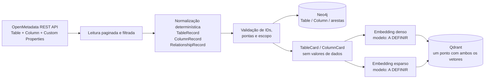

# ADR-0011: Contrato detalhado da ingestão OpenMetadata → Neo4j e Qdrant

- **Status**: Proposto
- **Data**: 2026-07-23
- **Autores**: arthrok (graphrag-tais)
- **Revisores**: -
- **Substitui**: [ADR-0005](./0005-ingestao-openmetadata-para-neo4j-e-qdrant.md)
- **Altera parcialmente**: política de versionamento de clientes do
  [ADR-0003](./0003-qdrant-como-vector-store.md)

## Introdução ao problema

O [ADR-0004](./0004-openmetadata-como-fonte-de-metadados.md) definiu o
OpenMetadata como fonte determinística de metadados, e o ADR-0005 definiu a
escrita dupla no Neo4j e no Qdrant. Essas decisões ainda deixam lacunas que
impedem implementar e conferir a ingestão sem decisões implícitas:

- quais endpoints, campos, filtros e regras de paginação serão usados;
- qual é o formato normalizado de tabela, coluna e relacionamento;
- o que vira nó, aresta e card pesquisável;
- como representar no grafo as relações semânticas do MCid sem chamá-las de FK;
- como gerar IDs estáveis e evitar duplicatas quando uma descrição muda;
- como armazenar, no mesmo ponto do Qdrant, vetores denso e esparso;
- quais escolhas ainda dependem de benchmark, especialmente os modelos de
  embedding.

O código atual já lê tabelas, colunas e FKs, cria nós `Table`/`Column`, arestas
`HAS_COLUMN`/`FOREIGN_KEY` e cards de tabela/coluna. Porém, ele também lê tipos
fora do escopo desta decisão, não filtra o catálogo, não fixa o ID dos cards,
não remove ou detecta tudo que ficou obsoleto e não consome as relações
semânticas publicadas nas Custom Properties do MCid.

Esta ADR especifica o contrato-alvo da primeira ingestão útil para o GraphRAG.
Ela é deliberadamente limitada ao que já possui base documental hoje:
**tabelas, colunas e relacionamentos entre elas**.

## Decisão

A ingestão fará uma leitura integral e determinística do escopo configurado no
OpenMetadata — o **snapshot de origem** — e produzirá um modelo canônico
intermediário formado por `TableRecord`, `ColumnRecord` e
`RelationshipRecord`. A partir do mesmo snapshot de origem:

- `TableRecord` e `ColumnRecord` viram nós no Neo4j e cards híbridos no Qdrant;
- `RelationshipRecord` vira uma aresta tipada no Neo4j;
- os relacionamentos relevantes são resumidos no texto e no payload dos cards
  de suas pontas, mas **não** viram um nó `Relationship` nem um
  `RelationshipCard` independente no v1.

Essa separação mantém uma responsabilidade clara:

- o Qdrant localiza semanticamente tabelas e colunas;
- cada card aponta para um `node_id` real;
- o Neo4j valida e expande os caminhos entre esses nós.



### 1. Escopo normativo

Entram nesta versão:

| Tipo canônico | Neo4j | Qdrant | Granularidade |
|---|---|---|---|
| `TableRecord` | nó `:Table` | um `TableCard` | uma unidade por tabela |
| `ColumnRecord` | nó `:Column` | um `ColumnCard` | uma unidade por coluna |
| `RelationshipRecord` | aresta tipada | projeção nos cards das pontas | uma unidade por relação ou par de colunas |

Ficam explicitamente fora do escopo:

- MetricFlow, métricas e o endpoint `/metrics`;
- granularidade (*grain*) e validação de *fan-out*;
- glossário e o endpoint `/glossaryTerms`;
- lineage de transformação e o endpoint `/lineage`;
- lineage em nível de coluna;
- `sampleData`, perfis, valores distintos ou qualquer valor de linha;
- relações inferidas apenas de coocorrência em consultas (`table.joins`);
- comunidades, `CAN_JOIN` derivada e ranking/fusão da recuperação.

Esses itens podem ser decididos posteriormente sem alterar a identidade dos
tipos definidos aqui.

### 2. Contrato de leitura do OpenMetadata

A primeira versão suportada é a API OpenMetadata `1.12.1`, alinhada ao cliente
de ingestão já usado para publicar os metadados do MCid. A versão da instância
deve ser conferida no início da execução; qualquer mudança exige teste de
contrato antes da ingestão.

Preflight:

```http
GET {OM_HOST}/api/v1/system/version
Authorization: Bearer {OM_JWT_TOKEN}
Accept: application/json
```

Versão diferente da configurada encerra a execução antes de ler entidades,
salvo quando aquela versão já tiver uma fixture de contrato aprovada.

#### 2.1 Listagem principal

Para cada schema permitido pela configuração:

```http
GET {OM_HOST}/api/v1/tables
Authorization: Bearer {OM_JWT_TOKEN}
Accept: application/json

databaseSchema={schema_fqn}
fields=columns,tableConstraints,tags,extension
include=non-deleted
limit={page_size}
after={cursor_opcional}
```

Regras:

1. `databaseSchema` vem de uma allowlist explícita. Não será lido todo o
   catálogo visível ao token.
2. `limit` é configurável e respeita o limite aceito pela versão da API.
3. O próximo cursor é exclusivamente `paging.after`; a leitura termina quando
   ele não existir.
4. `data[]` é a única lista de entidades consumida.
5. `columns` é lida aninhada na tabela; não há uma chamada por coluna.
6. `databaseSchema`, `database`, `service`, `id`, `name` e
   `fullyQualifiedName` são preservados quando presentes na resposta-base.
7. Entidade sem `fullyQualifiedName` válido não é inventada: ela é rejeitada e
   contabilizada.
8. Timeout, `429` e `5xx` repetem a mesma página até três vezes, com
   `Retry-After` quando presente e backoff exponencial com jitter; outros `4xx`
   não são repetidos.
9. Se uma página falhar após os retries, nenhuma escrita é iniciada.

Para retry ou diagnóstico de uma tabela específica:

```http
GET {OM_HOST}/api/v1/tables/name/{fqn_url_encoded}
  ?fields=columns,tableConstraints,tags,extension
```

O FQN deve ser codificado como segmento de URL. Erros `401`/`403`, shape
incompatível ou falha na listagem principal encerram a execução; não produzem
um snapshot parcial silencioso.

#### 2.2 Filtro de projeto

A configuração mínima do source deve conter:

```yaml
openmetadata:
  scope_id: mcid
  service: Cidades
  database: cidades
  relationship_adapter: mcid_markdown_v1
  schemas:
    - empreendimento_far
    - entidades_fds
    - conjuntura_bronze
    - conjuntura_silver
    - conjuntura_gold
```

`service` e `database` também são validados após a resposta. Uma tabela fora da
allowlist é descartada e registrada. Uma futura configuração por lista de
tabelas poderá restringir ainda mais o snapshot, sem mudar este contrato.

`scope_id` é obrigatório, estável e não muda quando a allowlist cresce. Escopos
devem ser disjuntos no v1: a mesma tabela não pode pertencer a dois `scope_id`.
Ele isola IDs, collections e filtros de recuperação.

#### 2.3 Relações semânticas do MCid

As FKs físicas vêm de `tableConstraints`. Relações adicionais entram por uma
interface configurável `RelationshipSourceAdapter`, que recebe as tabelas do
snapshot e devolve apenas `RelationshipRecord`. O núcleo não conhece nomes de
Custom Properties específicos de um órgão.

Para o scope MCid, o adapter opcional `mcid_markdown_v1` consome as relações
semânticas já publicadas no OpenMetadata em:

- `extension.mcidSemanticRelationships`: Markdown gerado e versionado por
  tabela;
- `extension.mcidRelatedTables`: referências navegáveis usadas para
  conferência das tabelas relacionadas.

`mcidRelatedTables` não contém chave, coluna, cardinalidade ou força e,
portanto, **não** cria aresta por si só.

No v1, o adapter lerá o cabeçalho e somente as linhas da seção
`Relações explícitas` que seguem a forma realmente produzida por
`render_table_markdown`:

```text
Catálogo `<catalog_id>`, evidência agregada de `<snapshot>`.

- **<classification>** (<role>): `<source>` → `<target>`;
  chave `<semantic_key>`; JOIN `<join_rule>`;
  cardinalidade `<cardinality>`; confiança `<confidence>`;
  <coverage_opcional>.
```

O adaptador:

1. aceita apenas `catalog_id`, versão de template e gramática conhecidos;
2. normaliza referências `schema.table.column` para o FQN completo do
   OpenMetadata;
3. exige que as duas tabelas e colunas existam no mesmo snapshot permitido;
4. usa `mcidRelatedTables` como verificação adicional das tabelas;
5. deduplica a mesma relação publicada nas duas pontas;
6. converte `Contrato validado por teste dbt` em
   `validation=dbt_relationships_test` e `Relação validada por agregados` em
   `validation=aggregate_validated`;
7. contabiliza `Relação candidata`, mas não a publica no grafo nem nos cards;
8. obtém `evidence_snapshot` do cabeçalho e preserva a cobertura opcional apenas
   como resumo agregado;
9. aborta o snapshot antes dos writers se uma relação admitida estiver
   incompleta; linha candidata malformada gera métrica e warning.

Uma fixture gerada pela versão corrente de `render_table_markdown` é o contrato
executável do parser. Alterar o template sem atualizar a fixture e o
`card_schema_version` deve quebrar o teste, não a ingestão em produção.

`join_rule=exact` é elegível para geração automática de JOIN no v1.
`normalized_exact` e outras regras são apenas evidência de descoberta até que
exista uma DSL versionada com expressões por dialeto. Elas entram no grafo e
nos cards com `sql_join_eligible=false`; o prompt não pode inventar `digits_only`,
padding ou transformação de tipo.

O Markdown é um contrato de compatibilidade, não o formato ideal entre
máquinas. Como evolução, o publicador deverá expor o mesmo catálogo como JSON
versionado em uma Custom Property textual própria. Essa troca afetará apenas o
adaptador de origem, não `RelationshipRecord`, Neo4j ou Qdrant.

### 3. Modelo canônico intermediário

O builder primeiro produz registros normalizados. Nenhum writer recebe o JSON
bruto do OpenMetadata.

#### 3.1 `TableRecord`

| Campo | Obrigatório | Regra |
|---|---:|---|
| `scope_id` | sim | escopo configurado |
| `node_id` | sim | FQN completo da tabela |
| `om_id` | sim | UUID da entidade no OpenMetadata |
| `name` | sim | nome técnico |
| `display_name` | não | nome de exibição |
| `description` | não | descrição documental |
| `service` | sim | serviço do OpenMetadata |
| `database` | sim | FQN do database |
| `schema` | sim | FQN do schema |
| `table_type` | não | tipo informado pelo OpenMetadata |
| `tags` | não | somente nomes/FQNs das tags |
| `source_updated_at` | não | timestamp da entidade na fonte |
| `ingestion_run_id` | sim | ID do snapshot que observou a entidade |

#### 3.2 `ColumnRecord`

| Campo | Obrigatório | Regra |
|---|---:|---|
| `scope_id` | sim | mesmo escopo da tabela |
| `node_id` | sim | FQN completo da coluna |
| `table_node_id` | sim | `node_id` da tabela pai |
| `table_om_id` | sim | UUID OpenMetadata da tabela pai |
| `name` | sim | nome técnico |
| `description` | não | descrição documental |
| `data_type` | sim | tipo lógico normalizado |
| `data_type_display` | não | representação completa do tipo |
| `ordinal_position` | sim | `ordinalPosition` ou, na ausência, posição no array |
| `constraint` | não | constraint declarada na coluna |
| `is_primary_key` | sim | derivado de coluna e `tableConstraints` |
| `tags` | não | somente nomes/FQNs das tags |
| `ingestion_run_id` | sim | ID do snapshot |

Uma coluna sem nome ou cujo pai não exista é rejeitada. O fallback
`{table_fqn}.None` é proibido.

#### 3.3 `RelationshipRecord`

`Relationship` é um tipo lógico intermediário e uma aresta no Neo4j, não uma
entidade genérica.

| Campo | Obrigatório | Regra |
|---|---:|---|
| `scope_id` | sim | escopo das duas pontas |
| `relationship_id` | sim | ID estável e determinístico |
| `relationship_type` | sim | `HAS_COLUMN`, `FOREIGN_KEY` ou `SEMANTIC_JOIN` |
| `source_node_id` | sim | FQN da origem |
| `target_node_id` | sim | FQN do destino |
| `source_table_node_id` | sim | FQN/`node_id` da tabela de origem |
| `target_table_node_id` | sim | FQN/`node_id` da tabela de destino |
| `source_kind` | sim | `structure`, `table_constraint` ou `mcid_markdown_v1` |
| `ordinal_position` | não | posição, usada por `HAS_COLUMN` |
| `constraint_group_id` | não | agrupa os pares de uma FK composta |
| `semantic_key` | não | chave de negócio, por exemplo `apf` |
| `join_rule` | não | regra documentada, por exemplo `normalized_exact` |
| `normalization_hint` | não | texto documental; nunca vira SQL diretamente |
| `cardinality` | não | cardinalidade declarada/observada |
| `confidence` | não | confiança publicada |
| `validation` | não | método de validação publicado |
| `evidence_snapshot` | não | versão/data da evidência, sem valores brutos |
| `coverage_summary` | não | evidência agregada sem valores de linha |
| `sql_join_eligible` | sim | true para FK e `exact`; false nos demais casos |
| `sql_eligibility_reason` | não | motivo legível quando false |
| `ingestion_run_id` | sim | ID do snapshot |

Identidade:

```text
relationship_id =
  sha256(
    "v1|" +
    scope_id + "|" +
    relationship_type + "|" +
    source_node_id + "|" +
    target_node_id + "|" +
    source_kind + "|" +
    coalesce(constraint_group_id, "") + "|" +
    coalesce(semantic_key, "") + "|" +
    coalesce(join_rule, "")
  )
```

Direção:

- `HAS_COLUMN`: `Table → Column`;
- `FOREIGN_KEY`: coluna local → coluna referenciada;
- `SEMANTIC_JOIN`: origem → destino conforme o catálogo curado.

Uma `SEMANTIC_JOIN` nunca recebe o tipo `FOREIGN_KEY`, mesmo com confiança alta.
Ela representa evidência para construir JOIN, não integridade referencial do
banco.

`FOREIGN_KEY` é `sql_join_eligible=true`. `SEMANTIC_JOIN` só é elegível quando
validada e `join_rule=exact`; relações que pedem normalização permanecem
pesquisáveis, mas carregam `sql_join_eligible=false` e a justificativa.

Os nomes `FOREIGN_KEY` e `SEMANTIC_JOIN` são o contrato normativo desta versão;
`FK_TO` no ADR-0002 era um exemplo conceitual, não um quarto tipo de aresta.

FK composta é preservada por `constraint_group_id` e gera uma aresta por par de
colunas. Se `columns` e `referredColumns` tiverem tamanhos diferentes, toda a
constraint é rejeitada; `zip()` silencioso é proibido.

### 4. Projeção no Neo4j

#### 4.1 Nós

O grafo normativo desta versão possui somente:

```text
(:Table {
  scope_id, node_id, om_id, name, display_name, fqn, description,
  service, database, schema, table_type, tags,
  source_updated_at, ingestion_run_id
})

(:Column {
  scope_id, node_id, table_om_id, name, fqn, description,
  data_type, data_type_display,
  ordinal_position, constraint, is_primary_key,
  table_node_id, tags, ingestion_run_id
})
```

`node_id = fullyQualifiedName` continua sendo a costura legível com o Qdrant.
`om_id` também é preservado nas tabelas para detectar renomeações de FQN.

As constraints mínimas são:

```cypher
CREATE CONSTRAINT table_node_id IF NOT EXISTS
FOR (n:Table) REQUIRE n.node_id IS UNIQUE;

CREATE CONSTRAINT column_node_id IF NOT EXISTS
FOR (n:Column) REQUIRE n.node_id IS UNIQUE;

CREATE CONSTRAINT table_om_id IF NOT EXISTS
FOR (n:Table) REQUIRE n.om_id IS UNIQUE;
```

#### 4.2 Arestas

```text
(:Table)-[:HAS_COLUMN {
  scope_id, relationship_id, ordinal_position,
  source_kind, ingestion_run_id
}]->(:Column)

(:Column)-[:FOREIGN_KEY {
  scope_id, relationship_id, constraint_group_id,
  sql_join_eligible, source_kind, ingestion_run_id
}]->(:Column)

(:Column)-[:SEMANTIC_JOIN {
  relationship_id, semantic_key, join_rule, cardinality,
  confidence, validation, evidence_snapshot,
  normalization_hint, coverage_summary,
  sql_join_eligible, sql_eligibility_reason,
  scope_id, source_kind, ingestion_run_id
}]->(:Column)
```

O upsert de aresta inclui `relationship_id`:

```cypher
MATCH (a:Column {node_id: row.source_node_id})
MATCH (b:Column {node_id: row.target_node_id})
MERGE (a)-[r:SEMANTIC_JOIN {
  relationship_id: row.relationship_id
}]->(b)
SET r += row.props
```

Cada tipo usa labels de ponta compatíveis; não haverá `MATCH` sem label. Uma
relação cuja ponta não exista não cria nó fantasma, não é contada como escrita
e faz a execução falhar na validação anterior ao writer.

#### 4.3 Contrato mínimo de travessia

O retriever deve subir de uma `Column` para sua `Table` por `HAS_COLUMN` e
expandir um hop por `FOREIGN_KEY` ou `SEMANTIC_JOIN`. Ao serializar o subgrafo,
ele preserva `join_rule`, `cardinality`, `confidence` e `validation`, para que a
geração de SQL não trate toda ligação como igualdade simples ou FK obrigatória.
Relações candidatas não entram nessa travessia porque não são persistidas no
contrato v1. Toda travessia filtra o `scope_id`; relações com
`sql_join_eligible=false` podem explicar descoberta, mas não entram na lista de
JOINs autorizados entregue ao gerador de SQL.

### 5. Projeção no Qdrant

#### 5.1 Tipos de card

O Qdrant recebe dois tipos:

**`TableCard`**

```text
Tipo: tabela
FQN: Cidades.cidades.empreendimento_far.empreendimento
Nome: empreendimento
Descrição: <descrição documental>
Schema: Cidades.cidades.empreendimento_far
Colunas: apf:TEXT; uf:TEXT; ...
Relacionamentos: apf -> cadastro_pj.apf
  [semantic_join, normalized_exact, many_to_one, confiança high,
   sql_join_eligible=false]
```

**`ColumnCard`**

```text
Tipo: coluna
FQN: Cidades.cidades.empreendimento_far.empreendimento.apf
Tabela: Cidades.cidades.empreendimento_far.empreendimento
Nome: apf
Tipo de dado: TEXT
Descrição: <descrição documental>
Chave primária: não
Relacionamentos:
- -> Cidades.cidades.empreendimento_far.cadastro_pj.apf
  [semantic_join, chave apf, normalized_exact, many_to_one, confiança high,
   sql_join_eligible=false]
```

As listas são ordenadas por FQN e `relationship_id`. O conteúdo é produzido por
template versionado, sem LLM e sem splitter: existe exatamente um card por
tabela e um por coluna. O TableCard resume nomes/tipos das colunas; a descrição
completa de cada coluna permanece no respectivo ColumnCard.

O `EmbeddingProfile` define `max_input_tokens`. Antes de embedding, o builder
mede o card com o tokenizer daquele perfil. Se exceder o limite, preserva nesta
ordem: identidade, descrição, relações elegíveis, demais relações e lista de
colunas. O excesso é truncado deterministicamente na fronteira de um item, e o
card termina com a contagem omitida. O payload registra
`content_truncated=true`, `omitted_column_count` e
`omitted_relationship_count`. Nenhum card pode ser cortado silenciosamente
pelo runtime do modelo.

`HAS_COLUMN` não é repetida como texto de relacionamento porque já está
implícita na estrutura do card. `FOREIGN_KEY` e `SEMANTIC_JOIN` são incluídas
nas duas pontas, com direção explícita.

Nenhum card contém amostra, valor distinto, estatística de valor, SQL com
literais ou PII encontrada em linhas. Apenas metadados documentais e evidência
agregada previamente publicada são permitidos.

#### 5.2 Identidade e payload

IDs lógicos:

```text
scope_namespace = uuid5(NAMESPACE_URL, "urn:graphrag-tais:" + scope_id)
card_id(Table)  = scope_id + "|table:"  + table_fqn
card_id(Column) = scope_id + "|column:" + column_fqn
point_id        = uuid5(scope_namespace, card_id)
```

O `point_id` é independente de descrição, tags ou relacionamentos. Assim, mudar
o conteúdo atualiza o mesmo ponto em vez de deixar uma versão antiga ao lado.

Payload lógico mínimo:

```json
{
  "scope_id": "mcid",
  "card_id": "mcid|column:Cidades.cidades.empreendimento_far.empreendimento.apf",
  "card_type": "column",
  "card_schema_version": "v1",
  "content": "<texto determinístico do ColumnCard>",
  "node_id": "Cidades.cidades.empreendimento_far.empreendimento.apf",
  "table_node_id": "Cidades.cidades.empreendimento_far.empreendimento",
  "table_om_id": "<uuid-da-tabela>",
  "fqn": "Cidades.cidades.empreendimento_far.empreendimento.apf",
  "relationship_ids": ["<sha256>"],
  "source_system": "openmetadata",
  "source_version": "1.12.1",
  "embedding_profile": "<A_DEFINIR>",
  "content_hash": "<sha256-do-conteudo>",
  "content_truncated": false,
  "omitted_column_count": 0,
  "omitted_relationship_count": 0,
  "ingestion_run_id": "<uuid>"
}
```

O TableCard carrega `om_id`; o ColumnCard carrega `table_om_id`.

Com `qdrant-haystack`, esses campos podem ser fisicamente serializados dentro
de `payload.meta`. Essa posição física é responsabilidade do adapter e deve ser
testada contra a versão pinada da biblioteca. Os consumidores usam os nomes
lógicos acima, não dependem de um caminho acidental de uma versão do pacote.

Isso altera a ação transitória do ADR-0003 de manter os clientes sem versão
fixa: identificado o Qdrant de destino, `qdrant-client` e `qdrant-haystack`
devem ser fixados como um par compatível e cobertos por teste de contrato.

Cada scope possui uma collection física por
`card_schema_version`/`embedding_profile`, por exemplo
`metadata_cards__mcid__v1__<profile>`, exposta pelo alias
`metadata_cards__mcid__current`. Além desse isolamento, toda consulta aplica
filtro obrigatório de `scope_id`.

Devem existir índices de payload para, no mínimo:

- `scope_id`;
- `card_type`;
- `node_id`;
- `om_id`/`table_om_id`;
- `embedding_profile`;
- `ingestion_run_id`.

Não haverá `RelationshipCard` no v1. Um card desse tipo teria duas pontas, mas o
retriever atual exige um único `node_id` correspondente a um nó real. O resumo
da relação nos cards das pontas preserva a descoberta sem reificar a aresta ou
introduzir outro contrato de sementes.

### 6. Vetores híbridos: denso e esparso

Cada ponto do Qdrant deve conter **os dois vetores sobre o mesmo conteúdo
versionado**:

```text
point
├── dense:  vetor denso
├── sparse: índices + pesos esparsos
└── payload: card + identidade + versões
```

Os nomes `dense` e `sparse` são lógicos. Se a integração Haystack usar nomes
físicos como `text-dense` e `text-sparse`, o adapter fará o mapeamento e sua
versão será pinada.

Uma falha em qualquer embedding invalida o ponto inteiro; não será gravado um
card com somente uma das representações. Na consulta, o modelo da pergunta deve
ser exatamente o mesmo perfil usado nos documentos.

#### 6.1 Modelos ainda a definir

Esta ADR **não aprova ainda os modelos de embedding**. Antes de mudar o status
para `Aceito`, deverá ser definido um `EmbeddingProfile` imutável:

| Item | Denso | Esparso |
|---|---|---|
| modelo e revisão/digest | **A DEFINIR** | **A DEFINIR** |
| runtime | **A DEFINIR** | **A DEFINIR** |
| dimensão | **A DEFINIR** | não se aplica como dimensão fixa |
| normalização | **A DEFINIR** | definida pelo modelo/tokenizer |
| prefixo de documento/query | **A DEFINIR** | **A DEFINIR** |
| licença e modo de hospedagem | **A DEFINIR** | **A DEFINIR** |
| limite de entrada | **A DEFINIR** | **A DEFINIR** |

Os defaults atuais são somente candidatos de desenvolvimento:

- denso: `nomic-embed-text`, servido pelo Ollama;
- esparso: `prithivida/Splade_PP_en_v1`, via FastEmbed.

Eles não devem ser tratados como escolha de produção. Em particular, o modelo
esparso atual é voltado ao inglês, enquanto as descrições e perguntas são
majoritariamente em português.

A seleção deverá comparar os candidatos em um conjunto versionado com:

- perguntas de negócio em pt-BR;
- siglas e nomes do domínio MCid;
- FQNs, `snake_case` e nomes de colunas;
- perguntas que dependem de uma chave de JOIN documentada.

Serão registrados pelo menos `Recall@10`, `MRR@10`, latência, memória, tamanho
do índice e cobertura dos quatro grupos acima. Os limiares de aceite e o perfil
vencedor ficam anexados a esta ADR durante a revisão.

`embedding_profile` deve identificar modelo, revisão, dimensão, normalização e
template. Nenhuma collection mistura perfis. Trocar modelo, dimensão ou
template exige reindexação completa em uma nova collection e troca de alias
após validação.

A estratégia de fusão na consulta — RRF, pesos, quotas por tipo e reranking —
não é decidida aqui. Esta ADR garante apenas que ambos os sinais estejam
presentes e versionados.

### 7. Ordem, idempotência e consistência

Cada execução gera um `ingestion_run_id` e segue esta ordem:

1. lê todas as páginas do escopo;
2. normaliza e deduplica os registros;
3. valida FQNs, relações e pontas;
4. compara os conjuntos de IDs da fonte com Neo4j e Qdrant;
5. se houver stale ou rename, para antes dos writers com
   `status=blocked_by_stale`;
6. grava constraints, nós e arestas no Neo4j;
7. somente após sucesso do grafo, gera ambos os embeddings;
8. faz upsert dos pontos estáveis no Qdrant com confirmação síncrona;
9. reconcilia contagens/IDs e, em uma collection nova, só então troca o alias;
10. publica o resumo da execução.

O preflight compara, sempre dentro de `scope_id`:

- `node_id` de Table/Column na fonte versus Neo4j;
- `card_id`/`point_id` esperados versus Qdrant;
- `relationship_id` esperado versus arestas Neo4j;
- `om_id` de Table versus seu FQN atual para detectar rename.

O relatório lista `stale_node_ids`, `stale_card_ids`,
`stale_relationship_ids` e `renamed_om_ids`. A especialização de reconciliação
desta ADR amplia a comparação básica de `node_id` do ADR-0007.

O Neo4j usa `MERGE` por `node_id`/`relationship_id`; o Qdrant usa upsert por
`point_id`. Reexecutar o mesmo snapshot converge sem duplicatas, inclusive após
alteração de descrição.

Não existe transação distribuída. A ordem escolhida prefere um estado
temporário com grafo atualizado e vetor atrasado a um card recuperável que
aponte para um nó inexistente. Se o Qdrant falhar, a execução falha e pode ser
repetida.

Remoção e rename não são apagados automaticamente no v1:

- stale ou rename bloqueia o run antes de uma nova publicação;
- o operador revisa o relatório, remove explicitamente os IDs obsoletos e
  reexecuta;
- após a escrita, `ingestion_run_id` confirma que nós, arestas e cards esperados
  foram tocados pelo mesmo run;
- nenhuma execução com stale, órfão ou ID não observado recebe
  `status=completed`.

Assim, “snapshot” nesta ADR significa snapshot completo **da fonte**. O destino
só é declarado convergente depois do preflight, da escrita e da reconciliação;
não se afirma que um simples upsert faça limpeza autoritativa.

### 8. Observabilidade e critérios de aceite

O resumo da execução deve conter:

- páginas e tabelas lidas por schema;
- tabelas e colunas aceitas/rejeitadas;
- relações por tipo, deduplicadas;
- constraints compostas ou relações sem pontas válidas;
- cards por tipo;
- embeddings densos/esparsos concluídos e falhos;
- nós, arestas e pontos efetivamente confirmados;
- versão da fonte, `card_schema_version`, `embedding_profile` e
  `ingestion_run_id`;
- stale/rename por tipo e `scope_id`;
- duração e erro por etapa, sem token ou conteúdo sensível.

A implementação satisfaz esta ADR quando:

1. duas execuções idênticas mantêm contagens, `node_id`, `relationship_id`,
   `card_id` e `point_id`; somente `ingestion_run_id` muda;
2. alterar uma descrição atualiza o mesmo ponto do Qdrant;
3. toda relação persistida possui duas pontas existentes e um ID estável;
4. relação semântica nunca aparece como FK física;
5. todo ponto contém vetor denso e esparso do mesmo perfil;
6. todo card recuperado possui `scope_id` e um `node_id` resolvível no Neo4j;
7. o source não chama endpoints fora do escopo;
8. nenhum valor de linha é lido ou vetorizado;
9. falha do Neo4j impede a escrita no Qdrant;
10. um teste de contrato usa uma fixture real anonimizada da versão suportada
    do OpenMetadata;
11. nenhum card excede `max_input_tokens` sem truncamento explícito no payload;
12. `sql_join_eligible=false` nunca entra nos JOINs autorizados do prompt;
13. stale ou rename produz `blocked_by_stale` antes de qualquer writer.

### 9. Diferenças para a implementação atual

Esta é uma decisão-alvo, não uma declaração de que todo o contrato já está
implementado. O código atual precisa ser ajustado para:

- filtrar schemas e paginar com os campos definidos;
- parar de buscar métricas, glossário e lineage nesta pipeline;
- implementar `scope_id`, collections isoladas e filtros obrigatórios;
- implementar a interface `RelationshipSourceAdapter` e o adapter opcional
  `mcid_markdown_v1`;
- consumir `extension` e normalizar relações semânticas;
- remover `Database`, `Schema`, `MetricFlow` e `GlossaryTerm` do contrato desta
  pipeline;
- preservar FK composta e validar as duas listas de colunas;
- criar constraints Neo4j e usar labels nos `MATCH`;
- fixar `Document.id`/`point_id` e o schema do payload;
- enriquecer TableCard/ColumnCard com relações;
- expandir e serializar `SEMANTIC_JOIN` no retriever de subgrafo;
- impedir que `sql_join_eligible=false` chegue como JOIN autorizado ao prompt;
- implementar preflight de stale/rename e reconciliação por `relationship_id`;
- ordenar a escrita Neo4j → Qdrant e esperar confirmação;
- fixar as versões dos adapters Qdrant/Haystack;
- implementar métricas de escrita real e testes de contrato.

Até esses itens serem concluídos, a execução atual é considerada um protótipo
compatível em parte, não conformidade total com a ADR-0011.

## Alternativas consideradas

### Alternativa A: criar `RelationshipCard` no Qdrant

- **Prós**: uma relação poderia ser recuperada diretamente como unidade.
- **Contras**: não existe nó `Relationship`; o card teria duas sementes e
  quebraria o contrato atual de um `node_id` por resultado. Também duplicaria
  texto já disponível nas duas pontas.
- **Decisão**: rejeitada no v1. As relações são projetadas nos cards das pontas.

### Alternativa B: reificar toda relação como nó Neo4j

- **Prós**: facilita anexar muitas propriedades e apontar um card para um nó.
- **Contras**: torna a travessia de schema mais verbosa, transforma
  `Table → Column` em entidades artificiais e não traz benefício para os três
  tipos atuais.
- **Decisão**: rejeitada. Relações permanecem arestas com propriedades.

### Alternativa C: consumir diretamente o YAML do catálogo MCid

- **Prós**: formato estruturado, preserva toda a evidência e o ID original.
- **Contras**: cria uma segunda fonte ao lado do OpenMetadata e contraria o
  ADR-0004. Um deploy do GraphRAG passaria a depender do repositório de dados.
- **Decisão**: rejeitada. O OpenMetadata continua sendo a fronteira da fonte;
  o formato estruturado deve ser publicado nele.

### Alternativa D: ingerir apenas FKs físicas

- **Prós**: sem parser de Custom Property e com semântica forte.
- **Contras**: no MCid analisado não há constraints FK físicas; seriam perdidas
  justamente as ligações documentadas e validadas para o GraphRAG.
- **Decisão**: rejeitada. FKs e relações semânticas ficam tipadas separadamente.

### Alternativa E: fixar agora os modelos default

- **Prós**: reduz configuração inicial.
- **Contras**: transforma conveniência de desenvolvimento em decisão
  arquitetural sem benchmark pt-BR; o sparse atual pode favorecer inglês.
- **Decisão**: rejeitada. O perfil de embedding é condição explícita para
  aceitar esta ADR.

### Não fazer nada / manter o status quo

- **Descrição**: manter leitura ampla, IDs derivados do conteúdo e writers
  independentes.
- **Por que não**: mudança documental cria duplicata no Qdrant, falha parcial
  produz divergência pouco observável e as relações semânticas do MCid não
  chegam ao grafo.

## Tradeoffs

### Vantagens

- **[Alto impacto]** Define uma costura verificável: todo card aponta para um nó
  real e toda relação possui pontas validadas.
- **[Alto impacto]** Preserva a diferença entre FK física e associação
  semântica, evitando que o LLM trate evidência como integridade garantida.
- **[Alto impacto]** IDs estáveis tornam reingestão e atualização documental
  realmente idempotentes.
- **[Médio impacto]** Vetores denso e esparso no mesmo ponto permitem busca
  semântica em pt-BR e recuperação lexical de siglas/FQNs.
- **[Médio impacto]** Escopo e ausência de valores de linha reduzem exposição de
  PII e custo de ingestão.

### Desvantagens

- **[Alto impacto]** O adaptador de Markdown MCid é deliberadamente rígido e
  terá de ser substituído por uma propriedade estruturada.
- **[Médio impacto]** Dual-write continua sem transação distribuída e remoção
  continua manual no v1.
- **[Médio impacto]** Enriquecer cards com relações aumenta o conteúdo e exige
  reindexar quando o catálogo relacional muda.
- **[Médio impacto]** A ADR permanece proposta até o benchmark escolher os
  modelos de embedding.
- **[Baixo impacto]** Database e Schema deixam de ser nós normativos nesta
  pipeline; continuam disponíveis como propriedades da tabela.

### Avaliação

Os ganhos superam os custos. O contrato reduz ambiguidades justamente onde um
GraphRAG de schema é mais sensível: identidade, semântica das ligações e
consistência entre os stores. Os riscos ativos são conhecidos e observáveis:
parser Markdown temporário, dual-write eventual, remoção manual e modelos ainda
pendentes de benchmark.

## Consequências

- **Positivas**: a ingestão pode ser implementada e testada por contrato; a
  busca híbrida consegue localizar entidades por linguagem natural, sigla e
  identificador técnico; o grafo distingue relações físicas e semânticas.
- **Negativas**: será necessária uma migração dos pontos atuais e uma revisão
  do pipeline/writers; troca de perfil sempre implica reindexação.
- **Ações decorrentes**:
  - implementar os três records e os dois templates de card;
  - publicar futuramente o catálogo semântico em Custom Property estruturada;
  - criar fixtures e testes de contrato OpenMetadata `1.12.1`;
  - criar constraints e índices de payload;
  - corrigir idempotência e ordenação dos writers;
  - implementar isolamento por scope e preflight de stale/rename;
  - ajustar retriever e prompt para respeitar `sql_join_eligible`;
  - definir futuramente uma DSL de normalização por dialeto;
  - executar o benchmark e preencher o `EmbeddingProfile`;
  - só então revisar o status desta ADR para `Aceito`.

## Referências

- [ADR-0001: GraphRAG como estratégia de recuperação](./0001-graphrag-como-estrategia-de-recuperacao.md)
- [ADR-0002: Neo4j como banco da camada de grafo](./0002-neo4j-como-banco-de-grafo.md)
- [ADR-0003: Qdrant como vector store](./0003-qdrant-como-vector-store.md)
- [ADR-0004: OpenMetadata como fonte de metadados](./0004-openmetadata-como-fonte-de-metadados.md)
- [ADR-0005: ingestão substituída por esta decisão](./0005-ingestao-openmetadata-para-neo4j-e-qdrant.md)
- [ADR-0007: reconciliação do v1](./0007-fechamento-dos-gaps-de-correcao-e-consistencia-do-v1.md)
- [OpenMetadata 1.12.x — List Tables](https://docs.open-metadata.org/v1.12.x/api-reference/data-assets/tables/list)
- [OpenMetadata 1.12.x — Get Table by FQN](https://docs.open-metadata.org/v1.12.x/api-reference/data-assets/tables/retrieve)
- [OpenMetadata — Custom Properties](https://docs.open-metadata.org/v1.12.x/developers/custom-properties)
- [OpenMetadata SDK — server version](https://docs.open-metadata.org/v1.12.x/api-reference/sdk/python/api-reference/server-mixin)
- Proveniência MCid no repositório `data-application-cidades`:
  `airflow_lappis/dags/openmetadata/semantic_relationships/mcid.yaml`,
  `airflow_lappis/dags/openmetadata/semantic_relationships.py` e
  `airflow_lappis/dags/openmetadata/RELATIONSHIP_COVERAGE.md`.
- Implementação atual:
  [`OpenMetadataSource`](../../src/rag/components/sources/openmetadata_source.py),
  [`GraphCardBuilder`](../../src/rag/components/converters/graph_card_builder.py),
  [`Neo4jGraphWriter`](../../src/rag/components/writers/neo4j_graph_writer.py) e
  [pipeline de ingestão](../../src/rag/pipelines/ingest/ingest_pipeline.py).
