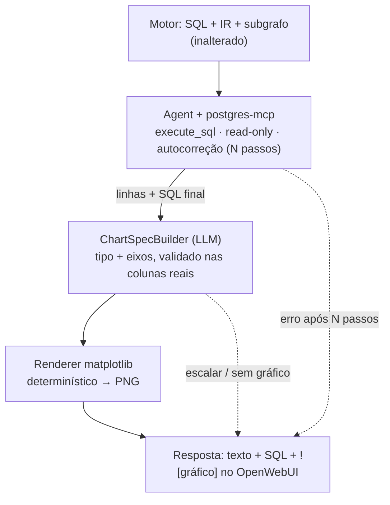

# ADR-0013: Execução do SQL via postgres-mcp com auto-correção e gráfico por chart-spec

- **Status**: Proposto
- **Data**: 2026-07-26
- **Autores**: Davi (graphrag-tais)
- **Revisores**: -

> Este ADR **revisa o mecanismo de execução** decidido no
> [ADR-0008](./0008-execucao-do-sql-e-visualizacao-no-v1.md) para o v1 (de
> conexão direta para `postgres-mcp` + agente) e **implementa** a etapa de
> gráfico da camada de entrega desenhada no
> [ADR-0010](./0010-camada-de-entrega-tabelas-grafico-explicacao-relatorio.md).
> Preserva do ADR-0008 os guardrails (read-only, SELECT-only, LIMIT, timeout) e
> a escolha do matplotlib; o Superset MCP segue como evolução v2.

## Introdução ao problema

A Retrieval v1 já leva a pergunta até o **SQL** (recuperação em duas camadas +
geração via LLM). Para fechar o produto, a próxima etapa é **gerar um gráfico**
do indicador e devolvê-lo junto do texto que já produzimos. Isso exige duas
coisas que ainda não existem:

1. **Executar o SQL contra o banco real** para obter linhas — sem dado não há
   gráfico. O SQL é gerado por LLM, então **pode vir errado** (coluna
   inexistente, tipo incompatível, JOIN mal formado): é preciso um mecanismo de
   **validação e retentativa**.
2. **Desenhar o gráfico** a partir do resultado, de forma previsível.

O [ADR-0008](./0008-execucao-do-sql-e-visualizacao-no-v1.md) decidiu, para o v1,
executar por **conexão read-only direta** (componente com `psycopg`/SQLAlchemy)
e validar SELECT-only com `sqlglot`, deixando a validação semântica (execução
real contra o banco) e o MCP como evolução futura. O
[ADR-0007](./0007-fechamento-dos-gaps-de-correcao-e-consistencia-do-v1.md) já
reconhecia que a validação **estrutural** não pega erros semânticos — só a
execução real pega.

O contexto mudou desde o ADR-0008: **o ambiente já roda um `postgres-mcp`**
(crystaldba) conectado ao banco analítico `cidades`, em modo **RESTRICTED**
(transações read-only, timeout de query, parsing via `pglast` que rejeita
`COMMIT`/`ROLLBACK`). Ou seja, o "custo de mais peças" que o ADR-0008 usou para
adiar o MCP **não se aplica** a este MCP — ele já existe e já impõe os
guardrails. E o Haystack expõe um componente `Agent` que roda o loop de
tool-calling nativamente, o que resolve a retentativa **sem** um loop manual.

Precisa ser decidido agora porque é o que destrava o gráfico, a explicação
ancorada em dados reais e o relatório.

## Decisão

No v1, o SQL gerado é **executado por um `Agent` do Haystack equipado com o
`postgres-mcp`** (tool `execute_sql`, em modo read-only): o agente roda o SQL e,
**se der erro, se autocorrige** usando o schema recuperado, limitado a
`max_agent_steps`. O gráfico é produzido em dois passos determinísticos: um LLM
emite uma **chart-spec estruturada** (tipo, eixos, série), validada contra as
colunas reais do resultado, e o **matplotlib renderiza** — *o LLM escolhe, não
desenha* (como no [ADR-0010](./0010-camada-de-entrega-tabelas-grafico-explicacao-relatorio.md)).
Tudo isso vive numa **pipeline de entrega separada** que consome o motor
(recuperação + SQL), deixando-o **inalterado e reusável**.

Regras da decisão:

1. **Execução via `postgres-mcp` (read-only).** O agente usa `execute_sql`; o
   modo RESTRICTED do servidor garante SELECT-only + timeout + rejeição de
   `COMMIT`/`ROLLBACK` — os guardrails que o ADR-0008 exigia, agora providos pelo
   próprio MCP em vez do `sqlglot`. Um `LIMIT` default é aplicado à consulta de
   dados do gráfico.
2. **Auto-correção limitada.** O `Agent` reexecuta e corrige até
   `max_agent_steps` (default baixo, ex.: 4–6). Se não conseguir, a entrega
   **não inventa dado**: devolve o texto+SQL já produzidos e sinaliza que a
   execução falhou.
3. **Gráfico por chart-spec + render determinístico.** O tipo de gráfico
   (barra, série temporal, ou "nenhum") e os eixos são escolhidos por um LLM com
   saída estruturada, **validados contra as colunas reais** do DataFrame; o
   matplotlib desenha. *Fallback*: resultado escalar/1 linha → mostra o número,
   sem gráfico. Reaproveita a biblioteca de plotagem interna existente
   (barra horizontal, série temporal, wordcloud + helper de estilo).
4. **Camada de entrega separada.** É uma pipeline própria (ADR-0010) que compõe
   o motor + execução + gráfico. O motor continua servindo qualquer consumidor
   (inclusive quem só quer o texto), sem tocar no banco.
5. **Entrega ao chat.** O PNG vai **embutido no Markdown como data URI base64**
   (``) — sem hosting próprio no v1. O
   MinIO/URL assinada fica para o relatório `.docx` (ADR-0010), não para o chat.
6. **Aditivo e tolerante a falha.** Execução e gráfico são **adicionais**: se
   qualquer um falhar, a resposta ainda entrega o que o motor já produz.

## Alternativas consideradas

### Alternativa A: Conexão direta `psycopg` + `sqlglot` + loop manual (ADR-0008 como escrito)

- Descrição: componente próprio abre conexão read-only, valida SELECT-only com
  `sqlglot` e um loop de reescrita limitado corrige o SQL.
- Prós: mais determinístico; menos dependência externa; é a decisão já
  documentada.
- Contras: **reintroduz credencial por banco** no serviço (o ADR-0004 evitou
  isso); a validação `sqlglot` é só estrutural — não pega erro semântico; e
  **duplica** infraestrutura que o `postgres-mcp` já provê aqui. O loop de
  reescrita seria código nosso a manter.

### Alternativa B: Agent + postgres-mcp + chart-spec (escolhida)

- Descrição: agente executa e autocorrige via MCP read-only; gráfico por
  chart-spec determinístico.
- Por que foi escolhida: a infra do MCP **já existe e impõe os guardrails**; a
  execução real pega os erros que a validação estrutural não pega (fecha a
  lacuna reconhecida no ADR-0007); e o `Agent` do Haystack **elimina o loop
  manual**. O graphrag não segura credencial — quem a tem é o MCP.

### Alternativa C: Dar ao Agent também uma tool de plotagem (tool-per-chart)

- Descrição: o agente decide chamar uma ferramenta de gráfico por tipo.
- Contras: amarra os tipos a tools nomeadas e depende de tool-calling para
  desenhar; menos determinístico. A chart-spec + dispatcher é mais constrita e
  consistente com a saída estruturada já usada na IR (mesma avaliação do
  ADR-0010).

### Não fazer nada / manter status quo

- Entregar só o SQL, sem executar: inviabiliza gráfico e explicação ancorada em
  dados. Não fecha o produto.

## Tradeoffs

### Vantagens

- **[Alto impacto]** Fecha a execução e o gráfico **reusando** o `postgres-mcp`
  já provisionado — sem o graphrag segurar credencial (alinhado ao ADR-0004) e
  com guardrails read-only prontos.
- **[Alto impacto]** A execução real **pega erros semânticos** (coluna/tipo/JOIN)
  que a validação estrutural do ADR-0007 não pegava; a auto-correção é nativa do
  `Agent`, sem loop manual.
- **[Médio impacto]** Chart-spec + render determinístico → gráfico **previsível e
  testável**; reaproveita a biblioteca de plotagem interna.
- **[Médio impacto]** Motor **inalterado e reusável** (entrega é pipeline à
  parte, ADR-0010).

### Desvantagens

- **[Alto impacto]** **Divergência do ADR-0008** (conexão direta) e do on-prem do
  ADR-0004/0009: o LLM da OpenAI, dirigindo o agente, **vê linhas do resultado**
  ao corrigir/plotar — não só metadados. Mitigação: passar ao LLM **resumo/
  amostra pequena**, não o dump completo; e manter sign-off de governança.
- **[Médio impacto]** **Não-determinismo e custo/latência** do loop agêntico
  (várias chamadas de LLM + round-trips ao MCP). Mitigado por `max_agent_steps`
  baixo e por `LIMIT` na consulta.
- **[Médio impacto]** **Correção semântica ainda não garantida** para grain/
  fan-out (o grafo não modela `grain`): a execução roda, mas o número pode estar
  semanticamente errado. Herdado do ADR-0010, permanece como limitação.
- **[Baixo impacto]** Novas dependências (`mcp-haystack`, `matplotlib`, `pandas`)
  e o primeiro uso de `Agent` no projeto.

### Avaliação

Os ganhos superam os custos **no v1**: a peça mais cara da Alternativa A (segurar
credencial + loop manual + validação só estrutural) é justamente o que o
`postgres-mcp` já resolve de graça neste ambiente, e a execução real fecha uma
lacuna que os ADRs anteriores já haviam precificado. O risco ativo a monitorar é
**o que trafega para o LLM** na auto-correção e no gráfico (linhas do resultado):
manter amostra/resumo, nunca o dump, e submeter a governança. O não-determinismo
é contido por `max_agent_steps`.

## Consequências

- **Positivas**: gráfico e explicação ancorados em dados reais destravados;
  guardrails read-only reusados do MCP; motor reusável; auto-correção sem código
  de loop próprio.
- **Negativas**: dado de resultado passa a ser visto pelo LLM (dívida de
  governança); latência/custo do agente; correção semântica (grain) ainda
  pendente; divergência consciente do ADR-0008.
- **Ações decorrentes**:
  - Novas dependências: `mcp-haystack`, `matplotlib`, `pandas` (e `wordcloud` se
    o renderer de nuvem for mantido).
  - Envs: `POSTGRES_MCP_URL` (SSE do `postgres-mcp`), `AGENT_MAX_STEPS`,
    `CHART_DPI`, `MAX_EXEC_ROWS`.
  - Componentes: `McpSqlExecutor` (Agent + `MCPToolset`), `ChartSpecBuilder`
    (LLM, saída estruturada), renderers + `ChartRenderer` (matplotlib → PNG),
    e a **pipeline de entrega** que os compõe.
  - Limitar o que vai ao LLM na correção/gráfico a **amostra/resumo** do
    resultado, nunca o dump completo.
  - Registrar no `README.md` dos ADRs; marcar que a **execução** do ADR-0008 foi
    revisada por este ADR (o Superset MCP segue como v2; o matplotlib e os
    guardrails do 0008 permanecem).

## Referências

- [ADR-0004: OpenMetadata como fonte de metadados](./0004-openmetadata-como-fonte-de-metadados.md)
- [ADR-0006: Interpretação da pergunta em uma representação estruturada (IR)](./0006-interpretacao-da-pergunta-em-representacao-estruturada.md)
- [ADR-0007: Fechamento dos gaps de correção e consistência do v1](./0007-fechamento-dos-gaps-de-correcao-e-consistencia-do-v1.md)
- [ADR-0008: Execução do SQL e visualização no v1](./0008-execucao-do-sql-e-visualizacao-no-v1.md)
- [ADR-0009: Modelo de embedding e composição do retrieval híbrido](./0009-modelo-de-embedding-e-composicao-do-retrieval-hibrido.md)
- [ADR-0010: Camada de entrega — tabelas, gráfico, explicação e relatório](./0010-camada-de-entrega-tabelas-grafico-explicacao-relatorio.md)
- [Haystack — Agent](https://docs.haystack.deepset.ai/docs/agent) · [MCPToolset](https://docs.haystack.deepset.ai/docs/mcptoolset)
- [postgres-mcp (crystaldba) — restricted mode, tools](https://github.com/crystaldba/postgres-mcp)
