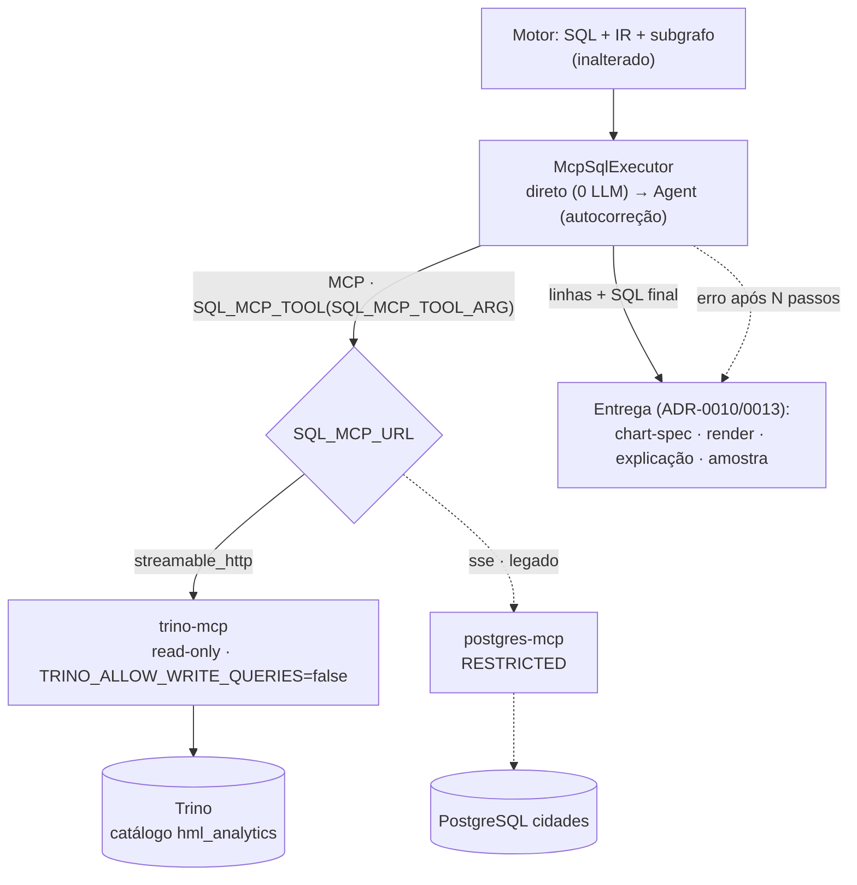

# ADR-0017: Execução do SQL via trino-mcp e contrato de backend configurável

- **Status**: Proposto
- **Data**: 2026-09-08
- **Autores**: Davi (graphrag-tais)
- **Revisores**: -

> Este ADR **revisa o mecanismo de execução** decidido no
> [ADR-0013](./0013-execucao-via-postgres-mcp-e-grafico-chart-spec-no-v1.md)
> (de `postgres-mcp` para `trino-mcp`). Preserva tudo o mais do 0013 — o `Agent`
> com auto-correção, os guardrails read-only providos pelo MCP, a chart-spec e
> o render determinístico — e mantém válida a decisão do
> [ADR-0004](./0004-openmetadata-como-fonte-de-metadados.md) de o graphrag **não
> segurar credencial de banco**. A camada de entrega do
> [ADR-0010](./0010-camada-de-entrega-tabelas-grafico-explicacao-relatorio.md)
> e a amostra do [ADR-0015](./0015-amostra-de-dados-reais-no-modo-explorar.md)
> continuam iguais: mudou **quem executa**, não o que se faz com o resultado.

## Introdução ao problema

O acesso ao dado analítico do GovHub passou a ser concedido por **usuário do
Trino**, não mais por usuário do PostgreSQL. O `postgres-mcp` do
[ADR-0013](./0013-execucao-via-postgres-mcp-e-grafico-chart-spec-no-v1.md) só
fala Postgres: mantê-lo significaria pedir uma credencial de banco que a
governança não emite mais — e sustentar dois caminhos de acesso ao mesmo dado.

A troca **não é só de endereço**. Quatro coisas mudam de fato, e cada uma
quebraria em silêncio se ficasse implícita:

1. **O dialeto do SQL.** O sistema é *text-to-SQL*: o LLM escreve o SQL, o
   `sqlglot` o valida e o **reescreve** (a guarda da amostra reemite a consulta
   dentro do envelope de `LIMIT`), e o `eval` mede fidelidade fazendo parse
   dele. Trino não é PostgreSQL — não tem `::`, `ILIKE`, `DISTINCT ON`,
   `to_char`, `string_agg`. Gerar Postgres e executar em Trino produz erro de
   sintaxe em consultas que estavam certas, e parse quebrado no `eval`.
2. **O nome da ferramenta MCP.** É `execute_query(query=…)` no trino-mcp e
   `execute_sql(sql=…)` no postgres-mcp. O nome estava **escrito no código** em
   três lugares (chamada direta, `tool_names` do toolset, varredura do histórico
   do Agent) e no prompt do executor.
3. **O transporte.** O postgres-mcp fala **SSE clássico** (GET abre o stream e
   informa o endpoint de POST). O trino-mcp publica `/mcp` **e** `/sse`, mas
   **os dois são Streamable HTTP** — o `/sse` é compatibilidade de rota, não de
   protocolo. Um cliente SSE clássico apontado para lá não conecta.
4. **A serialização do resultado.** O postgres-mcp devolve **repr Python**
   (`Decimal('...')`, `datetime.date(...)`) e sinaliza erro de banco como TEXTO
   com `isError=False` (a pegadinha que o ADR-0013 já documenta). O trino-mcp
   devolve **JSON** e marca `isError=True`.

Precisa ser decidido agora porque sem execução não há gráfico, não há explicação
ancorada em dado real e não há amostra — as três entregas que fecham o produto.

## Decisão

O SQL passa a ser executado pelo **`trino-mcp`** ([tuannvm/mcp-trino], Go),
rodando no compose como serviço próprio, em **modo somente-leitura**, e o
componente `McpSqlExecutor` deixa de conhecer backend: nome da tool, nome do
argumento, URL, transporte e dialeto viram **configuração** (`SQL_MCP_*` e
`SQL_DIALECT`). O `postgres-mcp` continua no repositório, atrás do profile
`postgres` do compose, alcançável trocando essas cinco variáveis.

Regras da decisão:

1. **Trino é o executor default; o catálogo é implícito.** A conexão do
   `trino-mcp` já fixa o catálogo (`TRINO_CATALOG=hml_analytics`), então o SQL
   continua referindo tabela por **`schema.tabela`** — igual ao que a
   serialização do subgrafo produz ([ADR-0011](./0011-contrato-detalhado-da-ingestao-openmetadata-neo4j-qdrant.md)).
   Nada no retrieval, no grafo ou na ingestão muda. **Pressuposto explícito**: os
   nomes de schema expostos pelo catálogo do Trino são os mesmos que o
   OpenMetadata ingeriu. Se divergirem, o conserto é no catálogo/ingestão, não
   no prompt.
2. **Read-only pelo servidor, como no 0013.** `TRINO_ALLOW_WRITE_QUERIES=false`
   (default) faz o trino-mcp aceitar apenas `SELECT`/`SHOW`/`DESCRIBE`/`EXPLAIN`
   e recusar DML/DDL — é o equivalente ao modo RESTRICTED que o ADR-0013 usava
   como guardrail. A guarda `sqlglot` da amostra ([ADR-0015](./0015-amostra-de-dados-reais-no-modo-explorar.md))
   continua sendo o cinto além do suspensório.
3. **Backend é configuração, não código.** `SQL_MCP_URL`,
   `SQL_MCP_TRANSPORT` (`streamable_http` | `sse`), `SQL_MCP_TOOL`,
   `SQL_MCP_TOOL_ARG` e `SQL_DIALECT`. O transporte é **campo explícito** porque
   não se deduz do path (ver o `/sse` do trino-mcp, que é Streamable HTTP).
4. **O dialeto é uma decisão de sistema, escrita em dois lugares.** `SQL_DIALECT`
   governa o `sqlglot` (guarda da amostra e introspecção do `eval`) e entra no
   prompt do executor; as **regras de dialeto** que o gerador precisa seguir são
   texto em `prompts/query_system.md`. Trocar um sem o outro gera SQL do dialeto
   errado — está anotado nos dois lados.
5. **O parser aceita os dois contratos.** `_parse_rows` lê JSON (trino) e repr
   Python (postgres); erro chega marcado (`isError`) ou como texto, e as duas
   formas viram a mesma falha legível. Isso é o que mantém o caminho legado vivo
   sem `if backend` espalhado.
6. **A ordem das colunas é reconstruída do SQL.** O trino-mcp serializa cada
   linha a partir de um `map[string]interface{}` do Go, e o `encoding/json`
   ordena chave **alfabeticamente**: `SELECT uf, total` voltaria como
   `total, uf` na tabela do chat, no CSV e no `.docx`. `_order_columns` reordena
   pela projeção do próprio SQL e, na menor dúvida (`*`, parse falho, conjunto
   diferente), devolve o que veio.
7. **Aditivo e tolerante a falha, como no 0013.** Sem execução, a resposta ainda
   entrega o que o motor produziu.

## Alternativas consideradas

### Alternativa A: manter o `postgres-mcp` apontando para o Postgres por trás do Trino

- Descrição: continuar acessando o PostgreSQL diretamente, ignorando o Trino.
- Prós: zero mudança de código; baseline do `eval` intocado.
- Contras: **depende de uma credencial que a governança não emite mais**. Mantém
  dois caminhos de acesso ao mesmo dado, com políticas de autorização
  diferentes — exatamente o que a adoção do Trino veio resolver. É dívida com
  prazo, não solução.

### Alternativa B: `trino-mcp` com o executor genérico (escolhida)

- Descrição: trocar o servidor MCP e tirar o backend do código.
- Por que foi escolhida: a credencial nova é de Trino; o `trino-mcp` provê o
  mesmo guardrail read-only que o ADR-0013 comprava do postgres-mcp; e
  parametrizar os quatro campos custa menos que o `if` que apareceria na
  primeira vez que alguém precisasse do outro backend — inclusive para
  **comparar** os dois durante a migração.

### Alternativa C: conexão direta ao Trino com o driver Python (`trino`)

- Descrição: um componente nosso abre a conexão, como o ADR-0008 propunha para
  o Postgres.
- Contras: **reintroduz credencial de banco no serviço** (o ADR-0004 evitou
  isso, e o ADR-0013 escolheu MCP justamente por isso), e obriga a reimplementar
  o guardrail read-only, o timeout e o teto de linhas que o servidor MCP já dá.
  Ganharíamos tipagem de coluna (que resolveria o item 6 e o decimal-string) —
  não compensa o que se perde.

### Não fazer nada / manter status quo

- Sem credencial de Postgres, a execução simplesmente para: some o gráfico, a
  explicação do resultado e a amostra. Sobra o texto e o SQL — o produto volta
  a ser o que era antes do ADR-0013.

## Tradeoffs

### Vantagens

- **[Alto impacto]** Volta a haver execução, com a **credencial que a governança
  de fato emite**, e sem o graphrag segurar senha de banco (ADR-0004).
- **[Alto impacto]** Um único caminho de acesso ao dado, com a autorização
  aplicada onde a instituição a administra (Trino), e não duplicada.
- **[Médio impacto]** Trocar de backend virou mudança de `.env`, o que torna a
  migração **reversível** e permite comparar os dois lados com o mesmo código.
- **[Médio impacto]** Erro de banco agora chega **marcado** (`isError`), que é o
  sinal que o ADR-0013 teve de inferir por heurística de texto.
- **[Baixo impacto]** A reescrita `sqlglot` no dialeto certo **conserta**
  Postgres-ismo simples da amostra (`uf::text` sai `CAST(uf AS VARCHAR)`).

### Desvantagens

- **[Alto impacto]** **O baseline do `eval` da resposta foi medido gerando
  PostgreSQL.** As regras de dialeto no `query_system.md` mudam o prompt da
  Persona 2 — território calibrado. O `make eval-answer` precisa rodar de novo
  contra o Trino antes de se afirmar qualquer número; até lá, o baseline
  anterior não é comparável.
- **[Médio impacto]** **`DECIMAL` chega como string** (limitação do driver Go do
  Trino, que não tem tipo decimal). Não convertemos: `"12345"` tanto pode ser um
  `SUM` quanto um código de IBGE, e transformar código em número estragaria
  rótulo de eixo e CSV. Os consumidores já coagem (`_infer_kinds`,
  `pd.to_numeric`, `_as_float`), então o gráfico sai — mas é uma imprecisão
  latente, e a raiz é o servidor não devolver tipo de coluna.
- **[Médio impacto]** **Sem metadado de coluna no envelope**, a ordem só existe
  porque a reconstruímos do SQL (regra 6). Onde a reconstrução não se aplica
  (`SELECT *`), a ordem exibida é alfabética.
- **[Baixo impacto]** Uma dependência a mais de terceiro (`ghcr.io/tuannvm/
  mcp-trino`), pinável por tag, no mesmo papel que o `crystaldba/postgres-mcp`
  ocupava.
- **[Baixo impacto]** `TRINO_VERIFY_TLS=false` na homologação: o servidor só tem
  a forma negativa (`TRINO_SSL_INSECURE=true`), então há duas variáveis
  descrevendo o mesmo fato, anotadas uma na outra.

### Avaliação

Os ganhos superam os custos porque a alternativa real não é "ficar como está" —
é **ficar sem execução**. O custo verdadeiro não é a troca de servidor (é
mecânica, e o `McpSqlExecutor` já tinha a forma certa), e sim o **dialeto**: ele
toca o prompt medido da Persona 2 e invalida a comparação com o baseline. Esse
custo é inevitável em qualquer caminho que leve ao Trino, e o mitigamos deixando
o dialeto explícito e reversível em vez de embutido. O risco a monitorar é
`DECIMAL` como string — é onde uma resposta pode sair *quase* certa.

## Consequências

- **Positivas**: execução restabelecida sobre a credencial correta; backend
  configurável (migração reversível e comparável); erro de banco marcado na
  origem; ordem de coluna preservada apesar da serialização do servidor.
- **Negativas**: baseline do `eval` da resposta precisa ser refeito; `DECIMAL`
  como string; ordem alfabética onde a projeção é `*`; TLS sem verificação na
  homologação.
- **Ações decorrentes**:
  - Envs novas: `TRINO_*` (conexão, lidas pelo container do MCP, nunca pelo RAG),
    `SQL_MCP_URL`, `SQL_MCP_TRANSPORT`, `SQL_MCP_TOOL`, `SQL_MCP_TOOL_ARG`,
    `SQL_DIALECT`. `POSTGRES_MCP_URL` vira legado (nenhum componente a lê).
  - Compose: serviço `trino-mcp`; `postgres-mcp` movido para o profile
    `postgres` (não sobe sozinho — sem `ANALYTICS_DB_*` ele entrava em loop de
    restart). `make up` passa a subir o `trino-mcp`.
  - Componentes: `McpSqlExecutor` agnóstico de backend (transporte, tool, arg,
    parse dos dois envelopes, `_order_columns`); `samples/sample_sql.py` e
    `eval/answer/sql_introspection.py` no dialeto configurado.
  - Prompts: `sql_executor_system.md` parametrizado (`{dialect}`, `{tool}`);
    `query_system.md` e `explore_system.md` com as regras de dialeto Trino.
  - **Rodar `make eval-answer` contra o Trino** e registrar o novo baseline
    antes de comparar qualquer métrica de resposta ([ADR-0012](./0012-desenvolvimento-orientado-a-metricas-no-retrieval.md)).
  - Verificar que os schemas do catálogo `hml_analytics` batem com os FQNs
    ingeridos do OpenMetadata (pressuposto da regra 1).
  - Registrar no `README.md` dos ADRs e marcar que a **execução** do ADR-0013 foi
    revisada por este ADR.

## Referências

- [ADR-0004: OpenMetadata como fonte de metadados](./0004-openmetadata-como-fonte-de-metadados.md)
- [ADR-0008: Execução do SQL e visualização no v1](./0008-execucao-do-sql-e-visualizacao-no-v1.md)
- [ADR-0010: Camada de entrega — tabelas, gráfico, explicação e relatório](./0010-camada-de-entrega-tabelas-grafico-explicacao-relatorio.md)
- [ADR-0011: Contrato detalhado da ingestão](./0011-contrato-detalhado-da-ingestao-openmetadata-neo4j-qdrant.md)
- [ADR-0012: Desenvolvimento orientado a métricas no retrieval](./0012-desenvolvimento-orientado-a-metricas-no-retrieval.md)
- [ADR-0013: Execução via postgres-mcp e gráfico por chart-spec](./0013-execucao-via-postgres-mcp-e-grafico-chart-spec-no-v1.md)
- [ADR-0015: Amostra de dados reais no modo Explorar](./0015-amostra-de-dados-reais-no-modo-explorar.md)
- [tuannvm/mcp-trino — tools, modo read-only, transporte HTTP](https://github.com/tuannvm/mcp-trino)
- [Trino — referência de SQL](https://trino.io/docs/current/sql.html) · [funções](https://trino.io/docs/current/functions.html)
- [trino-go-client — tipos (`DECIMAL` como string)](https://github.com/trinodb/trino-go-client)
- [Haystack — Agent](https://docs.haystack.deepset.ai/docs/agent) · [MCPToolset](https://docs.haystack.deepset.ai/docs/mcptoolset)

[tuannvm/mcp-trino]: https://github.com/tuannvm/mcp-trino
